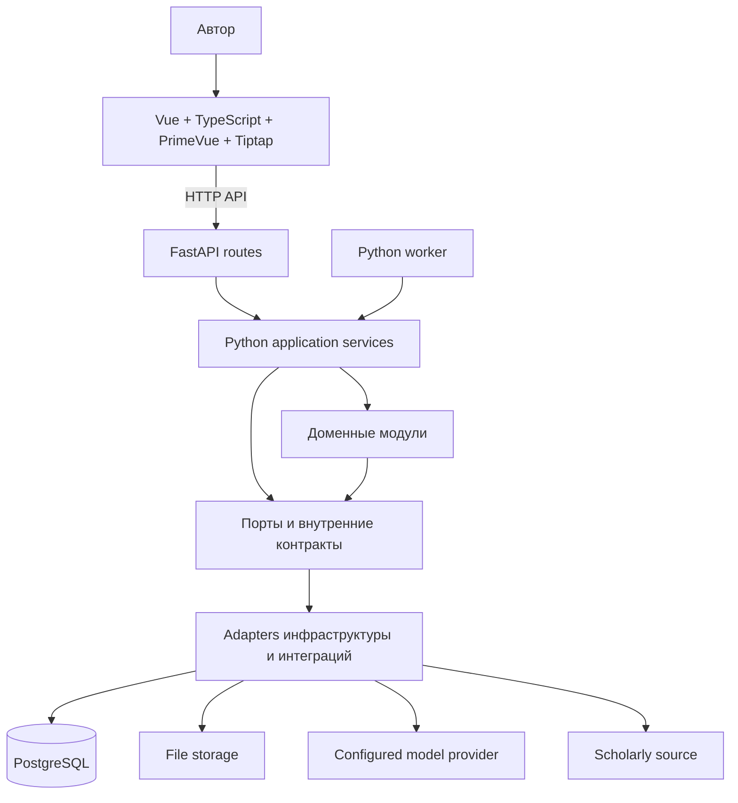

# Предложение по архитектуре системы и кода PaperWeave

> Документ описывает целевую архитектуру и явно отмечает проверенную границу MVP. Реализация не означает принятие всех предложений: обязательными остаются решения из принятых ADR и MVP-контракт.

Начальная основа реализована по [IMP-2026-001](plans/imp/imp-2026-001-mvp-foundation.md): локальные TOML/Compose runtime, Vue + PrimeVue 4 + TypeScript, FastAPI и PostgreSQL. Затем [IMP-2026-002](plans/imp/imp-2026-002-domain-workspace.md) добавил local-only identity/ownership, одну Tiptap-рукопись на проект с версионируемым JSONB, workspace UI, ручную PDF-библиотеку, extraction, Claim/Evidence review, mock-only AI proposals и DOCX export. Полный history browser, совместное редактирование, реальные внешние providers и production deployment остаются вне этого среза; итоговая сверка P1–P8 зафиксирована в TASK-014.

## Архитектурный стиль и развёртывание

Для первой версии предлагается Python modular monolith. Модули продукта находятся в одной кодовой базе и взаимодействуют через явные внутренние контракты. Отдельный Python worker может запускаться как другой процесс или container, используя тот же пакет и контракты хранения; технология очереди пока не выбрана.

Для локальной среды используется Docker Compose с PostgreSQL и приложением; PDF хранятся через `LocalFileStorage` в отдельном volume. По [ADR-0007](decisions/ADR-0007-local-identity-and-project-access.md) используется owner-managed accounts, PostgreSQL server-side sessions и обязательная project ownership. Production deployment, удалённый доступ, автоматическое резервное копирование и управление secrets не входят в текущую границу.

## Предлагаемый стек

| Область | Предложение | Статус и открытые вопросы |
|---|---|---|
| Язык и packaging | Python 3.12+, `uv` | Используются в локальном backend runtime; production packaging не проектировался |
| HTTP API | FastAPI + Pydantic | Используются в MVP; health и Projects API определены реализацией и контрактом MVP |
| Frontend | Vue 3 + TypeScript + PrimeVue 4 + Vue Router | Реализованы проекты UI и редактор рукописи; оформление использует Aura и готовые PrimeVue controls по [дизайн-коду](design-system.md) |
| Редактор рукописи | Tiptap Vue 3 + StarterKit | Используется в TASK-007 для блочного rich-text редактирования; текущий документ сохраняется целиком как JSONB snapshot |
| Хранение данных | PostgreSQL; pgvector — возможное будущее расширение | PostgreSQL хранит проекты, local identity/session, текущую рукопись, immutable manuscript revisions и AI proposals; векторы и их индексация не входят в текущий scope |
| Доступ к данным | SQLAlchemy + psycopg | Используются синхронно; отдельные repository adapters обслуживают проекты и рукописи |
| Изменение схемы | Alembic | Используется для последовательных миграций MVP |
| Интеграция с моделями | Внутренний `LLMService` со сменными adapters | P7 использует детерминированный mock; реальные providers, внешние вызовы, provider retries/budgets и structured output не реализованы |
| Файловое хранилище | Локальный файловый backend и S3 backend за общим storage-интерфейсом | Типизированные артефакты и lifecycle хранятся в PostgreSQL `file_artifacts`; локальный Compose предоставляет SeaweedFS 4.48 как S3 backend. Production-развёртывание и автоматический backup/restore не реализованы |
| Фоновые задачи | Отдельный Python worker | Будущее предложение; очередь/broker и фоновые jobs не входят в MVP |
| Локальная оркестрация | Docker Compose | Используется для локальных сервисов и изолированных тестов |
| Тесты | pytest, unit и integration | Используются; `make test` поднимает отдельную PostgreSQL в `tmpfs` |

`pyproject.toml` задаёт предварительные диапазоны backend-зависимостей и Python `>=3.12`; совместимость и поддерживаемая версия Python не подтверждены, а build backend не выбран. Frontend-манифест задаёт библиотеки по major-диапазонам; точные npm-версии зафиксированы в `frontend/package-lock.json`. Секреты, значения окружения и готовая конфигурация deployment не определены.

## Целевая структура кода

```text
paperweave/
├── pyproject.toml             # Метаданные Python-пакета и backend-зависимости
├── uv.lock                    # Зафиксированный граф Python-зависимостей
├── .env.example               # Имена настроек без секретных значений
├── compose.yaml               # Локальные сервисы разработки
├── Dockerfile                 # Образ backend-приложения
├── alembic.ini                # Настройки миграций Alembic
├── frontend/
│   ├── package.json            # Зависимости и команды frontend
│   ├── package-lock.json       # Зафиксированный граф npm-зависимостей
│   ├── index.html             # HTML-точка входа SPA
│   ├── tsconfig.json          # Настройки TypeScript
│   ├── vite.config.ts          # Сборка и локальный сервер frontend
│   └── src/
│       ├── main.ts             # Создание Vue-приложения и подключение PrimeVue
│       ├── App.vue             # Корневой компонент и общий каркас экранов
│       ├── api/                # Типизированный HTTP-клиент к backend API
│       ├── composables/        # Состояние и lifecycle UI-сценариев
│       ├── router/             # Маршруты SPA
│       ├── components/         # Переиспользуемые компоненты интерфейса
│       ├── editor/             # Tiptap-конфигурация и интеграция редактора
│       ├── styles/             # Общие токены и оформление PrimeVue
│       └── views/              # Экранные представления и композиция компонентов
├── src/paperweave/
│   ├── __init__.py             # Маркер Python-пакета
│   ├── main.py                 # Сборка зависимостей и запуск backend
│   ├── config.py               # Чтение и проверка конфигурации
│   ├── api/                    # HTTP-маршруты и схемы запросов/ответов
│   ├── services/               # Прикладные сценарии, общие для API и worker
│   ├── modules/
│   │   ├── projects/            # Исследовательские проекты
│   │   ├── library/             # Публикации и файлы источников
│   │   ├── evidence/            # Утверждения и доказательства
│   │   ├── manuscripts/         # Рукописи и редакции
│   │   └── jobs/                # Долгие фоновые задания
│   ├── integrations/
│   │   ├── llm/                 # Контракт LLMService и адаптеры провайдеров
│   │   ├── scholarly/           # Адаптеры научных баз и каталогов
│   │   └── documents/           # Адаптеры извлечения данных из документов
│   ├── infrastructure/
│   │   ├── db/                  # Подключение к БД и технические адаптеры
│   │   └── storage/             # Реализации файлового хранилища
│   └── worker.py                # Запуск обработки фоновых заданий
├── migrations/                 # Ревизии схемы Alembic
├── tests/
│   ├── unit/                   # Изолированные проверки модулей
│   └── integration/            # Проверки взаимодействия с БД и адаптерами
└── docs/                       # Документы проекта и архитектурные решения
```

Пути разделены по ответственности:

| Путь | Ответственность | Граница и запреты |
|---|---|---|
| `frontend/src/main.ts` | Создать Vue-приложение и подключить глобальные UI-плагины | Не размещать здесь маршруты экранов и бизнес-логику |
| `frontend/src/App.vue` | Определить корневой каркас SPA | Не владеть предметными правилами или HTTP-реализацией |
| `frontend/src/api/` | Предоставлять типизированные функции для вызовов backend API | Не содержать состояние отдельных экранов и правила предметной области |
| `frontend/src/components/` | Содержать визуальные компоненты с узкой повторно используемой ответственностью | Не связывать компоненты напрямую с базой данных или провайдерами |
| `frontend/src/editor/` | Настроить Tiptap, расширения и преобразование редакторского документа | Не быть источником бизнес-правил рукописи или самостоятельной системой хранения |
| `frontend/src/styles/` | Подключать тему PrimeVue и определять редкие общие проектные токены | Не переопределять PrimeVue глобальными селекторами и не дублировать стили редактора |
| `frontend/src/views/` | Собирать экран из компонентов, состояния и API-функций | Не дублировать общие компоненты и доменные проверки backend |
| `src/paperweave/main.py` | Собирать зависимости и запускать backend | Не размещать здесь предметные правила, HTTP-обработчики или цикл фоновой обработки |
| `src/paperweave/config.py` | Читать настройки окружения, проверять обязательные значения и предоставлять конфигурацию | Не хранить секреты в коде и не создавать подключения при импорте |
| `src/paperweave/api/` | Преобразовывать HTTP-ввод в вызовы прикладных сценариев и их результаты в ответы | Не выполнять прямые запросы к БД и не реализовывать многошаговые процессы |
| `src/paperweave/services/` | Координировать пользовательские сценарии, вызывая доменные модули и порты хранения | Не дублировать правила доменных модулей; одни и те же сценарии доступны API и worker |
| `src/paperweave/modules/projects/` | Владеть проектами исследования, настройками и их жизненным циклом | Не владеть публикациями, рукописью или глобальным подключением к БД |
| `src/paperweave/modules/library/` | Владеть библиографическими записями, файлами источников и их импортом | Не решать, подтверждает ли источник утверждение |
| `src/paperweave/modules/evidence/` | Владеть утверждениями, связями доказательств и состоянием проверки | Не принимать extraction или ответ AI за проверенный результат |
| `src/paperweave/modules/manuscripts/` | Владеть структурой рукописи и неизменяемыми версиями документа | Не управлять библиотекой или поставщиками моделей |
| `src/paperweave/modules/ai_proposals/` | Владеть lifecycle proposal, target revision и explicit author decision | Не вызывать внешний provider самостоятельно и не менять рукопись вне её versioned repository operation |
| `src/paperweave/modules/jobs/` | Владеть состояниями, прогрессом и правилами повтора заданий | Не запускать процессы инфраструктуры; обработку вызывает `worker.py` |
| `src/paperweave/integrations/llm/` | Реализовать внутренний контракт модели и адаптеры провайдеров | Не раскрывать типы SDK вендора предметным модулям и не менять текст без решения автора |
| `src/paperweave/integrations/scholarly/` | Преобразовывать внешние API научных источников во внутренние контракты | Не определять правила владения библиотекой и дедупликации |
| `src/paperweave/integrations/documents/` | Извлекать текст и координаты фрагментов из документов | Не решать за автора достоверность извлечённого фрагмента |
| `src/paperweave/infrastructure/db/` | Предоставлять подключение и технические адаптеры работы с БД | Не быть общим хранилищем доменных моделей всех модулей |
| `src/paperweave/infrastructure/storage/` | Реализовать чтение и запись файлов за внутренним интерфейсом | Не задавать правила доступа к источникам или библиотеки |
| `src/paperweave/worker.py` | Запускать обработку задания через `jobs` и прикладные сценарии | Не дублировать правила задания или других доменов |
| `migrations/` | Хранить последовательные изменения структуры БД | Не запускать прикладные процессы |
| `tests/unit/` | Изолированно проверять один модуль или контракт | Не требовать внешние сервисы |
| `tests/integration/` | Проверять работу границ модулей и адаптеров на выделенных ресурсах | Не использовать пользовательские или общие рабочие данные |
| `docs/` | Хранить описание продукта, архитектуры и решения | Документация не доказывает наличие реализации |

### Правила проектирования

- **Единственная ответственность (SRP):** модуль владеет одной предметной областью; технические слои отвечают за способ взаимодействия, а не за бизнес-правила.
- **Инверсия зависимостей (DIP):** прикладные сценарии зависят от внутренних контрактов; адаптеры подключаются на границе приложения.
- **OCP/LSP:** новую реализацию можно добавить за контрактом, не меняя вызывающий код, если она сохраняет семантику результата и ошибок этого контракта.
- **ISP:** контракты включают только операции, необходимые конкретному потребителю; универсальные интерфейсы «на все случаи» не вводятся.
- **DRY:** общую логику выделять после подтверждённого устойчивого повторения; не объединять разные понятия только из-за похожих полей.
- **KISS:** начинать с модульного монолита и одного необходимого пути выполнения; не добавлять брокер, слои или отдельные сервисы без подтверждённой потребности.
- **Направление зависимостей:** frontend обращается к backend через API; backend координирует прикладные сценарии, доменные модули используют внутренние контракты, а адаптеры реализуют их. Frontend и доменные модули не импортируют инфраструктурные детали друг друга.

Локальная основа P1–P8 реализована в `config.py`, `cli.py`, `api/`, `modules/projects/`, `modules/manuscripts/`, `modules/library/`, `modules/documents/`, `modules/evidence/`, `modules/ai_proposals/`, `infrastructure/db/`, миграциях и Vue `api/`, `components/`, `editor/`, `views/`. P7 использует только deterministic mock adapter в `integrations/llm/`; внешних LLM-вызовов нет. P8 добавляет `modules/manuscripts/docx_export.py` для чистого преобразования сохранённого Tiptap JSON в OOXML DOCX без записи данных; worker и scholarly integrations остаются каркасом.

Project workspace доступен по маршруту `/projects/:projectId` и использует существующие owner-scoped project/manuscript API. Vue shell отделяет навигацию проекта и оглавление, центральный Tiptap editor и правую контекстную область. Оглавление вычисляется из heading nodes текущего JSON документа; переход фокусирует соответствующий узел в редакторе и не создаёт отдельную backend-сущность раздела. Save, API и AI отображаются раздельно. P7 показывает mock-only предложение для выбранного текста, сохраняет context manifest и предлагает accept/reject; внешнего вызова модели нет. Если чтение manuscript завершается ошибкой, редактирование блокируется до повторной загрузки, чтобы не отправить неизвестную/устаревшую версию.

P8 добавляет inline `citation` node со ссылкой на Source ID и доступный только владельцу
`GET /projects/{project_id}/manuscript/export.docx`. Export читает сохранённый
manuscript, нумерует ссылки по порядку первого появления и формирует библиографию
из ручных Source metadata. Неизвестный или недоступный источник завершает экспорт
ошибкой; manuscript revisions не затрагиваются.

## Направление зависимостей



Доменный слой не должен напрямую импортировать SDK вендоров или HTTP-клиенты конкретных провайдеров. Adapters преобразуют внешние форматы во внутренние контракты. Слой приложения координирует сценарии, а модули владеют своими доменными правилами и переходами данных. Общие helpers добавляются, только если их оправдывает устойчивое повторение.

Основной поток редактирования: автор работает с блоком в Vue/Tiptap → frontend отправляет действие по HTTP в FastAPI → route проверяет транспортный запрос и вызывает Python application service → service применяет сценарий через доменные модули и порты → адаптеры читают/сохраняют данные в тех же хранилищах. Worker использует те же application services для фонового продолжения сценариев; отдельная копия бизнес-правил для API и worker не создаётся.

## Предлагаемая ответственность компонентов

- `main.py` связывает конфигурацию, адаптеры, API и точку входа worker; доменных правил в нём быть не должно.
- `config.py` разбирает конфигурацию и проверяет обязательные параметры; credentials не встраиваются в исходники.
- API routes проверяют транспортные данные и вызывают сценарии приложения; многошаговые доменные процессы не должны жить в routes.
- Frontend на Vue/PrimeVue показывает контекст источника, состояние проверки и предлагаемые изменения; Tiptap отвечает только за редактирование содержимого рукописи.
- `projects`, `library`, `evidence`, `manuscripts` и `jobs` отвечают каждый за свою ограниченную предметную область.
- Integrations отвечают за разбор протоколов и поведение провайдеров, предоставляя прикладному коду узкие контракты.
- Database- и storage-adapters реализуют порты хранения; бизнес-правила не должны зависеть от SQLAlchemy sessions или путей файловой системы.
- Worker получает и продвигает сохранённые jobs по определённым переходам состояния; retries и повторную доставку нужно спроектировать до production-использования.

## Нефункциональные ограничения дизайна

- Сохранять происхождение источника при импорте, извлечении, использовании доказательств, редактировании рукописи и экспорте.
- Записывать ошибки провайдеров, не заменяя корректные пользовательские данные частичным результатом.
- Делать AI-действия идемпотентными или безопасно повторяемыми, где это возможно; если повтор создаёт новый результат, задавать ему новый request ID.
- Делать передачу данных внешнему провайдеру видимой и связанной с конкретным провайдером и действием.
- Сохранять возможность экспорта материалов проекта: P8 задаёт начальный редактируемый DOCX; дополнительные форматы и расширенная библиографическая схема остаются будущими решениями.
- Соблюдать архитектурные gates репозитория из `.agents/AGENTS.md`; не дробить модули только ради размера файлов.

## Решения, необходимые до реализации

Модель удалённой authentication/tenants; провайдеры научного поиска; OCR, дополнительные форматы документов и точность anchors; очередь worker; sync/async-доступ к БД; автоматическое резервирование/retention для production; schema и privacy controls реального LLM-провайдера; права соавторов; topology deployment. Локальная authentication/ownership определены в ADR-0007. Начальные DOCX и citation rules определены ADR-0008; дополнительные export formats и полное bibliographic metadata schema требуют будущего решения.

## Подтверждения реализации

Реализованный локальный срез P1–P8 включает local runtime, Projects, manuscript/workspace, ручную библиотеку и PDF text extraction, Claim/Evidence review, mock-only AI proposals и DOCX export. Фактическое состояние и ограничения зафиксированы в [IMP.md](../IMP.md), [TASK-014 audit](evidence/verification/TASK-014-audit.md) и task-store. Реальный LLM provider, background worker/jobs, scholarly lookup и production deployment не подразумеваются кодом.

### Хранилище PDF библиотеки

API библиотеки проверяет текущую сессию и принадлежность проекта пользователю перед любым чтением или записью, включая download. Байты идут через выбранный storage backend; SQLAlchemy хранит метаданные, checksum и непрозрачный storage key в каталоге артефактов. Для локального backend Compose использует named volume `paperweave_files`; для S3 backend — SeaweedFS 4.48 с отдельным volume. PostgreSQL хранит `file_artifacts` и связь с `source_files`; API остаётся границей доступа и не выдаёт клиенту S3 credentials. Размер PDF ограничен 25 MiB. Согласованное восстановление требует совместимого снимка PostgreSQL и соответствующего файлового volume или S3 bucket; автоматический backup/restore и production storage не реализованы и остаются операционной ответственностью владельца. Контракт lifecycle описан в [хранении пользовательских файлов](storage-artifacts.md), команды локальной проверки — в [runbook](runbook-local.md#s3-и-seaweedfs).
# Извлечение документов (P5)

`POST .../files/{file_id}/extractions` проходит через owner-scoped API, `DocumentService`, локальный `pypdf` adapter и PostgreSQL repository. Операция синхронная в FastAPI worker thread и читает сохранённый PDF через выбранный файловый backend; OCR, сеть и очередь заданий не используются. Состояние запуска записывается до чтения и после извлечения. Ошибка разбора сохраняет исходный файл и становится видимой в run history. Текстовые passages возвращаются с номером страницы, идентификатором конкретного файла и review state. Тексты и extraction не маркируются проверенным evidence.
