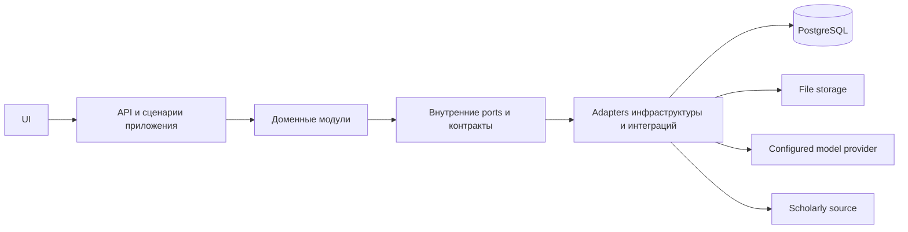

# Предложение по архитектуре системы и кода PaperWeave

> Это целевой дизайн, составленный по материалам пользователя. Архитектура ещё не реализована. Каждое существенное решение ниже остаётся предложением, пока соответствующий ADR не будет принят.

## Архитектурный стиль и развёртывание

Для первой версии предлагается Python modular monolith. Модули продукта находятся в одной кодовой базе и взаимодействуют через явные внутренние контракты. Отдельный Python worker может запускаться как другой процесс или container, используя тот же пакет и контракты хранения; технология очереди пока не выбрана.

Для начальной среды предлагается Docker Compose с PostgreSQL/pgvector, приложением и worker. Файлы хранятся в локальном volume за интерфейсом storage. Точная топология разработки и production, резервное копирование, аутентификация и управление secrets остаются открытыми вопросами.

## Предлагаемый стек

| Область | Предложение | Статус и открытые вопросы |
|---|---|---|
| Область | Предложение | Статус и открытые вопросы |
|---|---|---|
| Язык и packaging | Python-пакет `paperweave`; в целевой структуре указан `uv.lock` | Python предложен; packaging/build backend и поддерживаемая версия Python не выбраны |
| HTTP API | FastAPI + Pydantic | Предложено; контракты API не спроектированы |
| Первая GUI | NiceGUI | Предложено; детали взаимодействия с редактором открыты |
| Хранение данных | PostgreSQL + pgvector | Предложено; сценарии использования векторов и стратегия индексации требуют проверки |
| Доступ к данным | SQLAlchemy + psycopg | Предложено; sync/async-режим и границы транзакций не выбраны |
| Изменение схемы | Alembic | Предложено |
| Интеграция с моделями | Внутренний `LLMService` поверх LiteLLM SDK со сменными adapters | Предложено; список providers, retries, budgets и контракт structured output не определены |
| Файловое хранилище | Локальный volume за интерфейсом storage | Предложено; retention, encryption, backups и контракт перехода на object storage не определены |
| Фоновые задачи | Отдельный Python worker | Предложено; очередь/broker, семантика доставки и идемпотентность не определены |
| Локальная оркестрация | Docker Compose | Предложено; файлов Docker пока нет |
| Тесты | pytest, группы unit и integration | Предложено; жизненный цикл отдельной тестовой БД не спроектирован |

Здесь не зафиксированы версии и pins зависимостей, secrets, API keys, значения environment или утверждения о готовом deployment.

## Целевая структура кода

```text
src/paperweave/
├── main.py                 # Composition root и запуск приложения
├── config.py               # Граница чтения и проверки конфигурации
├── api/                    # HTTP routes и модели запросов/ответов
├── ui/                     # Страницы NiceGUI и взаимодействие с пользователем
├── modules/
│   ├── projects/            # Владение исследовательскими проектами
│   ├── library/             # Метаданные публикаций и ссылки на файлы
│   ├── evidence/            # Фрагменты, утверждения и связи поддержки/противоречия
│   ├── manuscripts/         # Разделы, блоки, редакции и цитирование
│   └── jobs/                # Состояние и сохранение долгих операций
├── integrations/
│   ├── llm/                 # Контракт LLMService и adapters провайдеров
│   ├── scholarly/           # Adapters поиска и метаданных научных источников
│   └── documents/           # Adapters разбора PDF и других документов
├── infrastructure/
│   ├── db/                  # Настройка SQLAlchemy и adapters хранения
│   └── storage/             # Реализация локального хранения за port-интерфейсом
└── worker.py                # Точка входа фоновых задач
migrations/                 # Ревизии Alembic
tests/unit/                  # Изолированные тесты доменов и adapters
tests/integration/           # Интеграционные проверки на тестовой БД и adapters
```

Каталоги задают границы реализации, а не требуют сразу создавать пустые пакеты. Начинать следует с минимального vertical slice через проекты, библиотеку, доказательства, рукопись и одно AI-действие.

## Направление зависимостей



Доменный слой не должен напрямую импортировать SDK вендоров или HTTP-клиенты конкретных провайдеров. Adapters преобразуют внешние форматы во внутренние контракты. Слой приложения координирует сценарии, а модули владеют своими доменными правилами и переходами данных. Общие helpers добавляются, только если их оправдывает устойчивое повторение.

## Предлагаемая ответственность компонентов

- `main.py` связывает конфигурацию, adapters, UI/API и точки входа worker; доменных правил в нём быть не должно.
- `config.py` разбирает конфигурацию и проверяет обязательные параметры; credentials не встраиваются в исходники.
- API routes проверяют транспортные данные и вызывают сценарии приложения; многошаговые доменные процессы не должны жить в routes.
- UI-страницы принимают действия автора и показывают контекст источника, состояние проверки и предлагаемые изменения.
- `projects`, `library`, `evidence`, `manuscripts` и `jobs` отвечают каждый за свою ограниченную предметную область.
- Integrations отвечают за разбор протоколов и поведение провайдеров, предоставляя прикладному коду узкие контракты.
- Database- и storage-adapters реализуют порты хранения; бизнес-правила не должны зависеть от SQLAlchemy sessions или путей файловой системы.
- Worker получает и продвигает сохранённые jobs по определённым переходам состояния; retries и повторную доставку нужно спроектировать до production-использования.

## Нефункциональные ограничения дизайна

- Сохранять происхождение источника при импорте, извлечении, использовании доказательств, редактировании рукописи и экспорте.
- Записывать ошибки провайдеров, не заменяя корректные пользовательские данные частичным результатом.
- Делать AI-действия идемпотентными или безопасно повторяемыми, где это возможно; если повтор создаёт новый результат, задавать ему новый request ID.
- Делать передачу данных внешнему провайдеру видимой и связанной с конкретным провайдером и действием.
- Сохранять возможность экспорта материалов проекта; форматы обмена ещё предстоит выбрать.
- Соблюдать архитектурные gates репозитория из `.agents/AGENTS.md`; не дробить модули только ради размера файлов.

## Решения, необходимые до реализации

Модель authentication и tenants; провайдеры научного поиска; PDF parser и стратегия anchors; очередь worker; sync/async-доступ к БД; резервирование и retention БД и файлов; schema запросов/ответов LLM, logging и privacy controls; стили цитирования и формат экспорта; права соавторов; topology deployment. Эти решения нельзя вывести из предложенного стека.

## Подтверждения реализации

Кода приложения, migrations, конфигурации Compose, тестов и runtime-подтверждений пока нет. По мере реализации этот документ нужно сверять с кодом и принятыми ADR.
