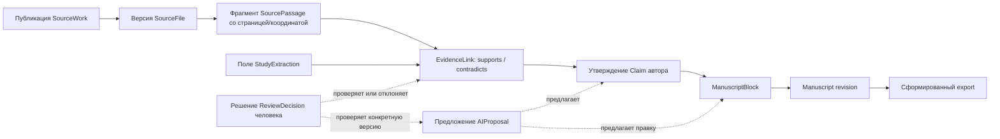

# Концептуальная модель данных PaperWeave

> Здесь описана целевая предметная модель и фактически реализованная основа. База проектов появилась в [IMP-2026-001](plans/imp/imp-2026-001-mvp-foundation.md); локальная идентичность и владение проектом добавлены по [ADR-0007](decisions/ADR-0007-local-identity-and-project-access.md) в TASK-006; первая версионируемая рукопись — в TASK-007.

## Реализованная модель MVP

В текущем срезе реализованы проект, локальные пользователи/сессии и одна рукопись на проект. Research question, библиотека и claims остаются будущими доменами:

| Таблица | Поле | Тип / ограничение |
|---|---|---|
| `projects` | `id` | UUID, primary key, генерирует backend |
| `projects` | `name` | `VARCHAR(200)`, обязательное; trim и проверка 1–200 символов выполняются до сохранения |
| `projects` | `description` | nullable `TEXT`, максимум 5000 символов на API boundary |
| `projects` | `created_at` | `TIMESTAMPTZ`, обязательное, задаётся PostgreSQL |
| `projects` | `owner_id` | UUID, обязательный FK на `users.id`; каждый запрос проекта ограничен текущим владельцем |
| `users` | `id`, `email`, `display_name`, `password_hash`, `role`, `created_at` | Локальная учётная запись; пароль — salted PBKDF2-HMAC-SHA256 hash; role — `owner` или `member` |
| `sessions` | `id`, `user_id`, `token_hash`, `created_at`, `last_activity_at`, `expires_at` | Серверная сессия в PostgreSQL; база хранит SHA-256 hash случайного cookie token |
| `manuscripts` | `id` | UUID, primary key |
| `manuscripts` | `project_id` | Обязательный уникальный FK на `projects.id` с cascade при удалении проекта; MVP допускает одну рукопись на проект |
| `manuscripts` | `content` | Обязательный PostgreSQL JSONB с корнем Tiptap `doc`; порядок элементов хранится в массиве `content` |
| `manuscripts` | `version` | Обязательный монотонный integer, начиная с 1; API обновляет только при совпадении `expected_version` |
| `manuscripts` | `updated_at` | `TIMESTAMPTZ`, время последнего сохранения |

Миграция `20261019_0002` создаёт резервированного владельца, назначает ему существующие проекты и делает `projects.owner_id` обязательным. Миграция `20261019_0003` создаёт `manuscripts`. Откат схемы выполняется только последовательными Alembic downgrade; операции проектов проходят через Projects service и persistence port, identity — через IdentityRepository, рукописи — через ManuscriptService и отдельный persistence adapter.

## Разделение основных областей

Три области должны быть связаны, но при этом различаться:

1. **Library:** собранные проектом научные публикации и файлы.
2. **Синтез доказательств:** что сказано во фрагменте источника, какое утверждение он может поддерживать или опровергать и проверил ли эту связь человек.
3. **Manuscript:** собственная аргументация автора и её упорядоченное, версионированное представление.

Одна ссылка на источник ещё не доказывает, что он подтверждает утверждение. Извлечённый текст автоматически не становится проверенным доказательством. Сгенерированное утверждение или абзац не считается одобренным автором содержимым, пока тот явно его не примет.

## Предлагаемые сущности

| Сущность | Предлагаемая идентичность и основные данные | Важные связи |
|---|---|---|
| ResearchProject | Стабильный ID, название, вопрос, область и конфигурация проекта | Владеет библиотекой, работой с evidence, рукописями и jobs |
| SourceWork | Стабильный локальный ID, DOI/provider ID при наличии, библиографические метаданные и их происхождение | Может иметь несколько файлов и извлечённых фрагментов |
| SourceFile | ID/версия файла, storage key, checksum, media type, состояние импорта | Принадлежит SourceWork; фрагменты ссылаются на конкретную версию файла |
| SourcePassage | ID фрагмента, диапазон текста, страница, координаты PDF при наличии, версия метода extraction | Ссылается на версию SourceFile; может быть связан с несколькими утверждениями |
| Claim | ID, формулировка автора, область, квалификатор достоверности, состояние проверки | Используется блоками рукописи и связан с evidence relations |
| EvidenceLink | Тип связи (`supports`, `contradicts`, `contextualizes` или другой тип), обоснование, состояние проверки | Связывает Claim с SourcePassage или проверенным результатом исследования |
| StudyExtraction | Структурированные поля методов, выборки, результата и ограничений с указанием происхождения значения | Каждое извлечённое поле ссылается на фрагменты источника и отличается от проверки автором |
| Manuscript | ID, название, целевой формат и метаданные редакций | Принадлежит проекту и содержит упорядоченные разделы/блоки |
| ManuscriptSection | ID, заголовок/тип и порядок раздела | Содержит упорядоченные блоки; может соответствовать стандартному разделу статьи |
| ManuscriptBlock | ID, тип, содержимое, порядок и версия блока | Может ссылаться на утверждения, цитаты, рисунки, таблицы или данные автора |
| Citation | ID, данные для форматирования в выбранном стиле и ссылка на источник | Используется в блоках; представление строится по метаданным и стилю |
| ReviewDecision | Проверяющий, объект/версия, решение, время и необязательная заметка | Фиксирует проверку extraction, evidence или AI-предложения; область и идентичность требуют уточнения |
| AIProposal | ID запроса/контекста, метаданные provider/model, результат и состояние | Целится в выбранный источник или версию блока; принятие создаёт редакцию, отклонение сохраняет исходный текст |
| Job | ID/тип, idempotency key, состояние, прогресс, краткая ошибка и время | Представляет импорт, extraction или AI-операцию вместе с историей повторов |

Собственные данные, таблицы и рисунки автора нужно отличать от результатов, извлечённых из внешних публикаций. Точные сущности и правила evidence для них следует определить отдельно.

## Граф происхождения данных

Пунктиром показаны связи проверки и предложения, а не автоматического принятия. Export должен сохранять разрешение цитат; нужно решить, будут ли в нём также метаданные происхождения.

## Вопросы идентичности и версионирования

- У публикации может быть несколько идентификаторов, изданий и локальных файлов; одного DOI недостаточно для идентификации всех работ.
- Anchors фрагментов можно переносить при замене PDF только если соответствие доказуемо; иначе они помечаются устаревшими для проверки.
- Принятая AI-правка должна создавать новую редакцию рукописи/блока, а не перезаписывать старую.
- Связь evidence должна указывать конкретный фрагмент и версию утверждения, для которых она была проверена.
- Дубликаты импорта нужно обнаруживать, не объединяя разные издания и не теряя пользовательские заметки.
- Удаление и retention исходных файлов не должны оставлять видимость того, что утверждения подтверждены недоступными или непрослеживаемыми доказательствами.

Эти вопросы остаются открытыми для будущей полной schema. Текущий документ Tiptap является единым JSONB snapshot с optimistic version token; таблица пока не хранит исторические snapshots, блоки с отдельными ID или связи citations/evidence.
