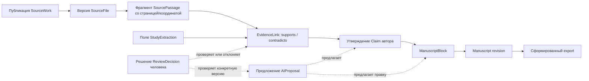

# Концептуальная модель данных PaperWeave

> Здесь описана целевая предметная модель и фактически реализованная форма локального среза P1–P8. Проекты появились в [IMP-2026-001](plans/imp/imp-2026-001-mvp-foundation.md); local identity/ownership — по [ADR-0007](decisions/ADR-0007-local-identity-and-project-access.md); рукопись, библиотека, passages, Claim/Evidence, mock AI proposals и citations/export — в TASK-007…TASK-013. Полная целевая модель ниже шире текущей схемы.

## Реализованная модель MVP

В текущем срезе реализованы проект и локальные пользователи/сессии, одна версионируемая рукопись на проект, ручные Source metadata/PDF files, ExtractionRun/SourcePassage, Claim/EvidenceLink/ReviewDecision, AIProposal и Citation marker для DOCX. Реализованные сущности ограничены условиями отдельных Tasks: нет ResearchQuestion, StudyExtraction, нескольких рукописей на проект или Job queue.

| Таблица | Поле | Тип / ограничение |
|---|---|---|
| `projects` | `id` | UUID, primary key, генерирует backend |
| `projects` | `name` | `VARCHAR(200)`, обязательное; trim и проверка 1–200 символов выполняются до сохранения |
| `projects` | `description` | nullable `TEXT`, максимум 5000 символов на API boundary |
| `projects` | `created_at` | `TIMESTAMPTZ`, обязательное, задаётся PostgreSQL |
| `projects` | `owner_id` | UUID, обязательный FK на `users.id`; каждый запрос проекта ограничен текущим владельцем |
| `users` | `id`, `email`, `display_name`, `password_hash`, `role`, `created_at` | Локальная учётная запись; пароль — salted PBKDF2-HMAC-SHA256 hash; role — `owner` или `member` |
| `sessions` | `id`, `user_id`, `token_hash`, `created_at`, `last_activity_at`, `expires_at` | Серверная сессия в PostgreSQL; база хранит SHA-256 hash случайного cookie token |
| `manuscripts` | `id` | UUID, primary key |
| `manuscripts` | `project_id` | Обязательный уникальный FK на `projects.id` с cascade при удалении проекта; MVP допускает одну рукопись на проект |
| `manuscripts` | `content` | Обязательный PostgreSQL JSONB с корнем Tiptap `doc`; порядок элементов хранится в массиве `content` |
| `manuscripts` | `version` | Обязательный монотонный integer, начиная с 1; API обновляет только при совпадении `expected_version` |
| `manuscripts` | `updated_at` | `TIMESTAMPTZ`, время последнего сохранения |
| `manuscript_revisions` | `manuscript_id`, `version`, `content`, `created_at` | Неизменяемый JSONB snapshot версии; уникальная пара manuscript/version; owner-scoped read API |

Миграция `20261019_0002` создаёт резервированного владельца, назначает ему существующие проекты и делает `projects.owner_id` обязательным. Миграция `20261019_0003` создаёт `manuscripts`; последующие миграции добавляют библиотеку, passages, claims/reviews и AI proposals. Откат схемы выполняется последовательными Alembic downgrade; операции проектов проходят через Projects service и persistence port, identity — через IdentityRepository, рукописи — через ManuscriptService и отдельный persistence adapter.

## Разделение основных областей

Три области должны быть связаны, но при этом различаться:

1. **Library:** собранные проектом научные публикации и файлы.
2. **Синтез доказательств:** что сказано во фрагменте источника, какое утверждение он может поддерживать или опровергать и проверил ли эту связь человек.
3. **Manuscript:** собственная аргументация автора и её упорядоченное, версионированное представление.

Одна ссылка на источник ещё не доказывает, что он подтверждает утверждение. Извлечённый текст автоматически не становится проверенным доказательством. Сгенерированное утверждение или абзац не считается одобренным автором содержимым, пока тот явно его не примет.

## Предлагаемые сущности

| Сущность | Предлагаемая идентичность и основные данные | Важные связи |
|---|---|---|
| ResearchProject | Стабильный ID, название, вопрос, область и конфигурация проекта | Владеет библиотекой, работой с evidence, рукописями и jobs |
| SourceWork | Стабильный локальный ID, DOI/provider ID при наличии, библиографические метаданные и их происхождение | Может иметь несколько файлов и извлечённых фрагментов |
| SourceFile | ID/версия файла, storage key, checksum, media type, состояние импорта | Принадлежит SourceWork; фрагменты ссылаются на конкретную версию файла |
| SourcePassage | ID фрагмента, диапазон текста, страница, координаты PDF при наличии, версия метода extraction | Ссылается на версию SourceFile; может быть связан с несколькими утверждениями |
| Claim | UUID, текст из рукописи, manuscript block position, Claim version и manuscript version | Связан только с рукописным утверждением; собственные результаты автора вне P6 |
| EvidenceLink | Отдельный UUID, Claim/version, Passage и точный SourceFile, typed relation, rationale, review state | `supports`, `contradicts`, `contextualizes`; сама связь не является проверкой |
| StudyExtraction | Структурированные поля методов, выборки, результата и ограничений с указанием происхождения значения | Каждое извлечённое поле ссылается на фрагменты источника и отличается от проверки автором |
| Manuscript | ID, название, целевой формат и метаданные редакций | Принадлежит проекту и содержит упорядоченные разделы/блоки |
| ManuscriptSection | ID, заголовок/тип и порядок раздела | Содержит упорядоченные блоки; может соответствовать стандартному разделу статьи |
| ManuscriptBlock | ID, тип, содержимое, порядок и версия блока | Может ссылаться на утверждения, цитаты, рисунки, таблицы или данные автора |
| Citation | Inline Tiptap-узел с UUID источника | В реализации P8 marker хранит только `sourceId`; форматирование разрешается при экспорте по Source текущего проекта |
| ReviewDecision | Неизменяемая запись reviewer, EvidenceLink version, решение, UTC-время и заметка | В P6 её создаёт единственный владелец; другие review domains вне задачи |
| AIProposal | ID запроса/контекста, метаданные provider/model, результат и состояние | Целится в выбранный источник или версию блока; принятие создаёт редакцию, отклонение сохраняет исходный текст |
| Job | ID/тип, idempotency key, состояние, прогресс, краткая ошибка и время | Представляет импорт, extraction или AI-операцию вместе с историей повторов |

Собственные данные, таблицы и рисунки автора нужно отличать от результатов, извлечённых из внешних публикаций. Их атрибуция и evidence workflow не входят в P6.

## Граф происхождения данных

Пунктиром показаны связи проверки и предложения, а не автоматического принятия.
P8 DOCX разрешает citation marker к записи Source, нумерует по первому появлению
и строит список литературы из имеющихся ручных метаданных. Citation не означает
Evidence и не удостоверяет Claim.

## Вопросы идентичности и версионирования

- У публикации может быть несколько идентификаторов, изданий и локальных файлов; одного DOI недостаточно для идентификации всех работ.
- Anchors фрагментов можно переносить при замене PDF только если соответствие доказуемо; иначе они помечаются устаревшими для проверки.
- Принятая AI-правка должна создавать новую редакцию рукописи/блока, а не перезаписывать старую.
- Связь evidence должна указывать конкретный фрагмент и версию утверждения, для которых она была проверена.
- Дубликаты импорта нужно обнаруживать, не объединяя разные издания и не теряя пользовательские заметки.
- Удаление и retention исходных файлов не должны оставлять видимость того, что утверждения подтверждены недоступными или непрослеживаемыми доказательствами.

Текущий документ Tiptap является единым JSONB snapshot с optimistic version token; P6 хранит Claim block position в конкретной версии, а не постоянный ID узла. Структурные ID блоков и перенос Claim между редакциями остаются будущим улучшением.

## Библиотека источников (TASK-009)

`Source` принадлежит `Project` и хранит библиографические поля с `metadata_provenance=manual`. DOI нормализуется как введённый пользователем идентификатор, но внешнего DOI/scholarly lookup нет. В пределах проекта нормализованный DOI уникален: повторная запись возвращает конфликт с ID существующего источника; автоматическое слияние не выполняется, чтобы не потерять пользовательские поля.

`SourceFile` — неизменяемая загруженная версия PDF, принадлежащая `Source`; версия монотонно увеличивается. Для одной записи запрещена повторная загрузка тех же байтов (SHA-256). Ограничение — 25 MiB; проверяются MIME и сигнатура `%PDF-`. Имя исходного файла сохраняется только как display metadata, а storage key строится из случайного UUID и не содержит пользовательского пути. Версии не перезаписываются при загрузке новой версии. Явные ссылки доменов на версию регистрируются в `SourceFileReference`; FK с `RESTRICT` и use case не позволяют удалить версию, пока на неё ссылаются Passage/Evidence. TASK-010 создаёт ссылки Passage; TASK-011 создаёт Evidence-ссылки и отвечает за их review lifecycle. Удаление требует явного действия владельца после UI-предупреждения.
## Извлечение документов (P5)

- `ExtractionRun` фиксирует каждую явную попытку обработки конкретной `SourceFile`, версию обработчика, состояние (`running`, `complete`, `empty`, `partial`, `failed`), число страниц и ошибку.
- `SourcePassage` хранит непустой текст страницы, `page_number`, `run_id` и точный `file_id`. Связь с файлом имеет состояние `unreviewed`; извлечение само по себе не подтверждает утверждение.
- `SourceFileReference` связывает passage с версией файла и хранит `review_state`. Загрузка новой версии переводит ссылки на прежние версии из `unreviewed` в `needs_review`; удаление файла ограничено внешними ключами, пока ссылки существуют.
- Повтор обработки создаёт новый `ExtractionRun` и новые passages, сохраняя предыдущий результат для аудита.

## Claims и evidence review (P6)

`Claim` ограничен утверждениями рукописи и хранит `manuscript_id`, позицию
блока, `version` и `manuscript_version`. `EvidenceLink` отдельно хранит Claim
version, Passage ID, SourceFile ID, manuscript version, relation и состояние
`unreviewed` / `verified` / `rejected` / `needs_review` / `retracted`. Допустимы typed relations
`supports`, `contradicts`, `contextualizes`. Только явный owner review создаёт
`ReviewDecision` с reviewer, временем, решением и заметкой; цитата или
извлечённый текст не равны проверке.

Редактирование Claim либо сохранение новой версии рукописи помечает связанные
ссылки `needs_review`. Evidence-ссылка удерживает конкретную версию PDF от
удаления. Подробный контракт: [SPEC-2026-002](specs/spec-2026-002-evidence-workflow.md).

## AI proposals (P7)

`ManuscriptRevision` сохраняет неизменяемый JSON snapshot каждой сохранённой версии рукописи и выдаётся только через owner-scoped version API. `AIProposal` принадлежит проекту и конкретной рукописи; уникальный idempotency key scoped к проекту предотвращает дублирование одного действия. Запись сохраняет target manuscript version/position, точный context manifest (выбранный текст и instruction), mock/provider metadata, suggestion, статус и решение reviewer/time/note. Ошибка adapter сохраняет только тип ошибки, без raw prompt/response в технических логах. Удаление проекта каскадно удаляет proposals. В P7 единственный адаптер — deterministic mock; сетевой provider и передача контента выключены. Принятие условно на совпадение target version и текста в locator, создаёт следующую manuscript version и атомарно фиксирует решение; оригинальный selected text остаётся в manifest; исходная полная версия доступна через `manuscript_revisions`.
