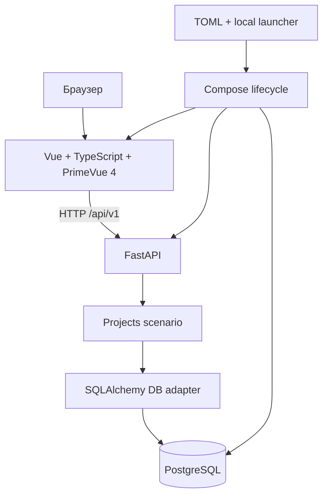
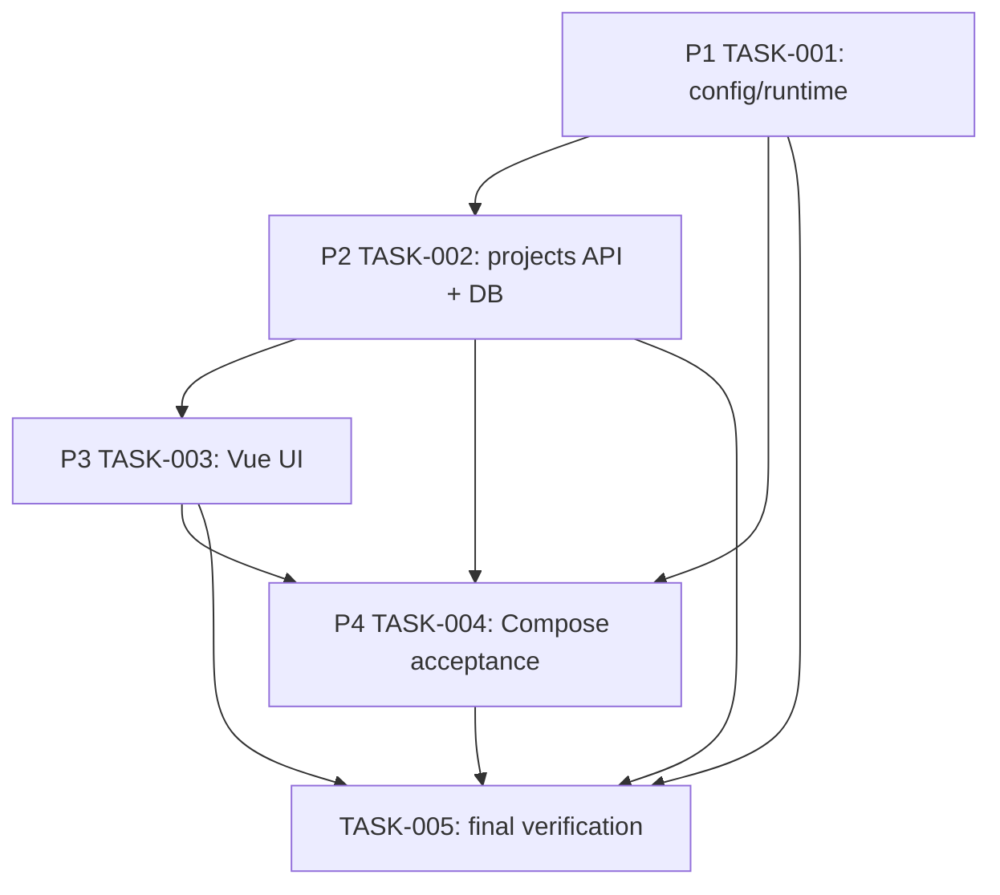

# Первый MVP PaperWeave — Implementation Plan

## Standalone scope contract

**Outcome:** локально запускаемая система PaperWeave предоставляет health-проверки и сценарий создания, списка и просмотра проектов исследования с сохранением данных в PostgreSQL.
**Acceptance criteria:** `AC-1`…`AC-9` описаны в черновом [Spec](../../specs/spec-2026-001-mvp-foundation.md); текущую узкую границу утверждает [ADR-0006](../../decisions/ADR-0006-mvp-boundary.md).
**Non-goals:** PDF ingestion, LLM, embeddings/pgvector, worker/jobs, library/evidence/manuscript, Tiptap editing, auth, collaboration, public/production deployment.
**Evidence:** unit/integration checks на изолированных ресурсах, config/schema validation, frontend typecheck/build, локальный Compose/browser/API acceptance и сохранение данных между перезапусками.
**Source:** request:2026-10-19-paperweave-mvp-foundation
**Decisions:** ADR-0006 принят владельцем проекта как узкая основа текущего MVP; Vue + PrimeVue 4 + TypeScript — прямое требование пользователя; NiceGUI из PDF не применяется; последующие возможности оформляются отдельными ADR.

Создание этого плана и Task package не разрешает реализацию. Начинать кодовые изменения можно после отдельного явного поручения пользователя; внешние публикация и deployment остаются отдельной границей.

Implementation requires explicit user authorization; registering these Tasks grants no implementation or deployment authority.

## Analysis: child skill result

| Field | Value |
|---|---|
| Child skill | `imp-analysis` |
| Analysis status | `complete` (`ready`) |
| Analysis artifact | `artifacts/plan-analysis/imp-2026-001-mvp-foundation-2026-10-19.md` |
| Architecture status | `complete` (`pass_with_conditions`) |
| Architecture artifact | `artifacts/architecture/imp-2026-001-mvp-foundation-2026-10-19.md` |
| Open blocker refs | None IMP-wide; phase-local conditions in architecture report |

## Audited context

Контракт источника: standalone direct request + принятое продуктовое решение ADR-0006. Черновой Spec — подробная трассировка поведения, не требующийся approval prerequisite. Baseline: `b1ecdc91c41d6cf2f38b74af001d181eeefa6c3e`; рабочее дерево уже содержало ранее внесённые scaffold/docs изменения, которые сохраняются.

## General requirements and constraints

### Must not change

- Не реализовывать исключённые ADR-0006 возможности, включая редактор Tiptap, пока отдельное решение не расширит scope.
- Не публиковать PostgreSQL-порт на host; не открывать API/UI за пределы loopback по умолчанию.
- Не использовать `.env` в качестве второго пользовательского config source; не помещать реальные секреты в Git или логи.
- Не удалять volume/данные через `down`, проверки или migration rollback.
- Не менять shared/production среды, не делать push/deploy.

### Allowed change surface

Runtime/config/Makefile/Compose/Dockerfile; `src/paperweave/api`, `modules/projects`, `infrastructure/db`; `migrations`; `frontend`; `tests`; связанная документация, task cards и derived indexes.

### Environment matrix

| Environment | In scope? | Purpose | Required evidence | Mutation authorization |
|---|---|---|---|---|
| local | yes | изолированный MVP runtime и проверки | config, tests, migration, browser/API and persistence evidence | `not_required` |
| ci | no | не требуется этим планом | not applicable | `not_requested` |
| test | no shared | только owned temporary test resources | cleanup/evidence | `not_required` |
| staging | no | не входит | not applicable | `not_requested` |
| production | no | не входит | not applicable | `not_requested` |

### Required clarifications

Материальных вопросов к владельцу нет. Доступный браузеру API base URL для двух Compose-сервисов — реализационная задача P3/P4: контейнерный DNS не разрешается браузером пользователя. Решение должно оставаться конфигурируемым и loopback-only.

## Fixed decisions and invariants

| Решение / инвариант | Правило | Последствие |
|---|---|---|
| Узкий MVP | Сначала локальный запуск, health, Projects CRUD-minimum и persistence | Функции продукта добавляются отдельными ADR/Specs |
| Frontend | Vue + TypeScript + PrimeVue 4; готовые PrimeVue controls по дизайн-коду | NiceGUI не использовать; Tiptap не входит в этот MVP |
| Single config source | TOML читается launcher-ом и передаётся в сервисы | Не допускать второй пользовательской config-поверхности через `.env` |
| Persistence | PostgreSQL — источник истины для проектов; миграции Alembic | Tests используют только отдельные ресурсы |
| Exposure | API/UI published только на loopback; DB только внутри Compose | Local MVP не становится публичным сервисом |
| Readiness | live независим от БД, ready зависит от БД; migration до app readiness | Ошибка DB/migration не скрывается как готовность |
| Идемпотентность запуска | `init` не перетирает конфиг; `down` не удаляет volume; `up` повторяем | Сохранность пользовательских данных |

## Target model

`Project` имеет UUID, `name`, optional `description`, UTC `created_at`; его lifecycle пока ограничен созданием и чтением. UI владеет только представлением и HTTP interaction; API — transport validation; Projects сценарий — прикладным поведением; DB adapter — persistence; Alembic — версией схемы; Compose launcher — lifecycle и передачей конфигурации. PostgreSQL остаётся единственным хранилищем проекта.

## Work groups and dependency graph

| Group | Purpose | Phases | Outcome |
|---|---|---|---|
| G1 | Повторяемое конфигурирование и локальный runtime | P1 | TASK-001 |
| G2 | Persistence и HTTP contract | P2 | TASK-002 |
| G3 | Пользовательский интерфейс проектов | P3 | TASK-003 |
| G4 | Сквозная локальная приёмка | P4 | TASK-004 |

## Architecture findings and phase gates

| Finding ID | Scope | Phase IDs | Exit condition |
|---|---|---|---|
| ARCH-MVP-01 | phases | P1,P4 | TOML source, mounted config, safe logs proven |
| ARCH-MVP-02 | phases | P1,P4 | loopback UI/API, internal-only DB proven |
| ARCH-MVP-03 | phases | P3,P4 | browser-reachable API URL selected and verified |
| ARCH-MVP-04 | phases | P2,P4 | readiness/liveness and migration ordering proven |
| ARCH-MVP-05 | phases | P2,P4 | test data/resource isolation demonstrated |

## Phase 1: Конфигурация и локальный запуск

Phase ID: `P1`; status `ready`; Task [TASK-001](../../../tasks/TASK-001.md).

### Goal and input

**Goal:** получить воспроизводимую локальную среду через TOML и Compose launcher.
**Inputs:** scaffold `compose.yaml`, `Dockerfile`, `src/paperweave/config.py`, текущие lockfiles, PDF AC-1…AC-3 и AC-8…AC-9.

### Preconditions and scope / non-scope

Готово к реализации: подтверждены узкий scope, frontend choice, local-only exposure и config rules. В этой фазе не реализуются API, доменная модель Projects или UI сценарии.

### Affected entities, flows and code

Config source, local service lifecycle, host/container network boundary. Файлы config loader/sample, launcher, Makefile, Compose/Docker, `.gitignore`, config tests и docs.

### Expected result

Настройки валидируются до старта; команды запускают только локальные процессы; DB volume сохраняется при остановке. Safe-stop: приложения могут оставаться заглушками, runtime/config contract тестируем.

### Tasks and ownership

| # | Task | Owner | Evidence |
|---|---|---|---|
| 1.1 | Реализовать TOML schema, loader, defaults, validation и init | Config/runtime | unit tests и `make config-check` |
| 1.2 | Реализовать launcher, Compose ordering/network/volume, Make commands | Runtime | command/config inspection, isolated Compose checks |

### Data and compatibility

- Приложение принимает только конфигурационный TOML; контейнеры видят read-only config.
- `config.example.toml` — шаблон; локальный `config.toml` исключён из Git.
- `down` не удаляет volume. Любые destructive target запрещены.

### Acceptance criteria

- `AC-P1-001`: валидный/невалидный config распознаётся предсказуемо, секрет не логируется.
- `AC-P1-002`: defaults ports 18741/18742 и их переопределение приходят из TOML.
- `AC-P1-003`: UI/API публикуются на loopback; DB не публикуется; `down` сохраняет данные.
- `AC-P1-004`: init/config-check/up/down/restart/logs/ps/migrate/test/help согласованы и ошибочные migrations не дают приложению стартовать как ready.

### Verification

- `make config-check` и соответствующая изолированная config test suite.
- Проверить конфигурацию Compose и launcher на default и изменённых портах; подтвердить отсутствие host mapping у DB.
- Убедиться, что init не изменяет существующий config и down не содержит volume deletion.

### Evidence contract

| Type | Command/source | Environment | Result | Observed at | Artifact |
|---|---|---|---|---|---|
| test | `make config-check`; config-focused target из Makefile | local | passed (`make test`: 8 passed) | 2026-10-19 | TASK-001 evidence |
| source | Compose config/launcher inspection | local | passed: loopback UI/API; DB без host mapping; `down` сохраняет volume | 2026-10-19 | TASK-001 evidence |

### Exit criteria

- Все P1 AC выполняются и evidence записано в TASK-001.
- Безопасность port bindings, no-secret logs и data-retaining down проверены.

## Phase 2: Projects persistence и API

Phase ID: `P2`; status `pending`; зависит от P1; Task [TASK-002](../../../tasks/TASK-002.md).

### Goal and input

**Goal:** реализовать минимальный API `/api/v1` и PostgreSQL Project storage.
**Inputs:** P1 config/DB URL contract, draft Spec, accepted ADR-0006.

### Preconditions and scope / non-scope

P1 завершён. Реализуются только health и проекты: schema, SQLAlchemy, Alembic, endpoints, validation/error semantics и isolated tests. Нет edit/delete/pagination или других доменов.

### Affected entities, flows and code

`ENTITY-PROJECT`, project create/list/detail flow, DB session boundary, API status/error responses.

### Expected result

API выполняет live/ready и проекты по контракту; данные сохраняются PostgreSQL. Safe-stop: UI может ещё отсутствовать.

### Tasks and ownership

| # | Task | Owner | Evidence |
|---|---|---|---|
| 2.1 | Создать модель, repository/service seam, DB wiring и начальную Alembic migration | Projects + DB | migration/unit/integration evidence |
| 2.2 | Создать health/projects endpoints и request/response/error validation | API | API contract tests |

### Data and compatibility

Начальная таблица `projects(id UUID, name VARCHAR(200), description TEXT nullable, created_at TIMESTAMPTZ)`. Schema только через Alembic. Не подключать тесты к обычной volume.

### Acceptance criteria

- `AC-P2-001`: migration создаёт целевую схему; downgrade policy не удаляет пользовательскую БД автоматически.
- `AC-P2-002`: live не зависит от DB; ready 503 при DB outage.
- `AC-P2-003`: create validation, duplicate names, sorting и detail 200/404/422 соответствуют Spec.
- `AC-P2-004`: unit/integration tests используют только выделенные test resources.

### Verification

- backend unit + integration tests через `make test` с isolated DB/fixture configuration.
- проверить upgrade на пустой test DB и повторяемое применение миграций.
- проверить endpoint contract для успеха и ошибок, включая DB unavailability.

### Evidence contract

| Type | Command/source | Environment | Result | Observed at | Artifact |
|---|---|---|---|---|---|
| test | `make test` (isolated PostgreSQL, migration twice, API contract) | local/test | passed (16 passed) | 2026-10-19 | TASK-002 evidence |
| source | migration + API contract | local | passed: projects schema, Alembic revision and endpoints match contract | 2026-10-19 | TASK-002 evidence |

### Exit criteria

- P2 AC и тесты проходят; SQLAlchemy/session details не просачиваются в API/UI.
- Test DB separation подтверждена конфигурацией и выполнением.

## Phase 3: Vue UI сценарий проектов

Phase ID: `P3`; status `pending`; зависит от P2; Task [TASK-003](../../../tasks/TASK-003.md).

### Goal and input

**Goal:** предоставить главную страницу и страницу проекта поверх HTTP API.
**Inputs:** стабильный P2 API contract, `docs/design-system.md`.

### Preconditions and scope / non-scope

P2 endpoints доступны и документированы. Frontend: Vue 3 + TypeScript + PrimeVue 4. Tiptap не включать; визуальный стиль следует дизайн-коду и готовым компонентам PrimeVue.

### Affected entities, flows and code

Browser/API flow, health polling lifecycle, create form submission, project list/detail navigation. Только `frontend/` и связанная API client/config.

### Expected result

Пользователь видит состояние API, создаёт проект, обновляет список и просматривает detail. Safe-stop: сценарий функционирует против доступного API, Compose E2E ещё остаётся.

### Tasks and ownership

| # | Task | Owner | Evidence |
|---|---|---|---|
| 3.1 | Настроить Vue app, PrimeVue preset/theme/component usage and routing | Frontend | typecheck/build and UI inspection |
| 3.2 | Реализовать health status, form, list, detail and error states | Frontend | UI/API tests or bounded browser evidence |

### Data and compatibility

UI обращается по HTTP и не импортирует backend/internal model. Browser-facing API URL должен разрешаться браузером; Compose internal DNS адрес для браузера не подходит. URL берётся из runtime config без публичного bind.

### Acceptance criteria

- `AC-P3-001`: health polling раз в 10 секунд не перекрывается и lifecycle timer очищается.
- `AC-P3-002`: создание блокирует кнопку, сохраняет форму при ошибке, не повторяет POST автоматически.
- `AC-P3-003`: list refresh/detail показывают согласованные backend data.
- `AC-P3-004`: health states различимы; outage не ломает UI; дизайн опирается на PrimeVue.

### Verification

- `npm --prefix frontend run typecheck` и `npm --prefix frontend run build`.
- UI tests/bounded browser scenario: initial status/list, successful create, API failure, detail navigation.

### Evidence contract

| Type | Command/source | Environment | Result | Observed at | Artifact |
|---|---|---|---|---|---|
| build | `npm --prefix frontend run typecheck && npm --prefix frontend run build` | local | unavailable до выполнения | при P3 | TASK-003 evidence |
| manual/test | браузерный сценарий главная→создание→detail | local | unavailable до выполнения | при P3 | TASK-003 evidence |

### Exit criteria

- P3 AC и frontend checks выполнены; browser-visible API URL проверен на runtime topology.

## Phase 4: Сквозная локальная приёмка

Phase ID: `P4`; status `pending`; зависит от P1, P2, P3; Task [TASK-004](../../../tasks/TASK-004.md).

### Goal and input

**Goal:** проверить реальный local Compose сценарий и data persistence, не изменяя пользовательские данные.
**Inputs:** работающие P1 config/runtime, P2 API/DB, P3 UI.

### Preconditions and scope / non-scope

Использовать только выделенную тестовую конфигурацию, тестовые порты и owned volumes/resources. Не запускать production/shared systems; не выполнять удаление пользователя данных.

### Affected entities, flows and code

Service ordering, migration gate, UI→API→DB flow, persisted Project after app restart, outage handling.

### Expected result

Локальная система проходит user journey и сохраняет данные после restart; runtime failures видны. Safe-stop: test-owned resources очищены, пользовательский volume не тронут.

### Tasks and ownership

| # | Task | Owner | Evidence |
|---|---|---|---|
| 4.1 | Выполнить smoke с созданием проекта и restart persistence | Runtime/verifier | local runtime observation |
| 4.2 | Проверить readiness failure/migration failure/API outage и cleanup | Runtime/verifier | failure-path evidence |

### Data and compatibility

Изолировать тестовые ресурсы именованным test-specific config/project; не переиспользовать default user volume для destructive fixture/setup.

### Acceptance criteria

- `AC-P4-001`: Compose запускает DB→migration→API/UI и возвращает доступные UI/API.
- `AC-P4-002`: созданный проект сохраняется после остановки и повторного запуска.
- `AC-P4-003`: readiness, API outage и ошибочная migration показывают корректное состояние.
- `AC-P4-004`: cleanup удаляет только подтверждённые test-owned временные ресурсы.

### Verification

- Воспроизводимый `make up`/browser or HTTP create/`make down`/`make up`/list verification на test-specific config.
- Проверить зависимость readiness от DB, API/UI recovery и итоговую очистку временных ресурсов.

### Evidence contract

| Type | Command/source | Environment | Result | Observed at | Artifact |
|---|---|---|---|---|---|
| runtime | isolated Compose lifecycle + API/browser smoke | local | unavailable до выполнения | при P4 | TASK-004 evidence |
| runtime | test-owned outage/migration-failure paths | local | unavailable до выполнения | при P4 | TASK-004 evidence |

### Exit criteria

- P4 AC подтверждены; test-owned containers/resources очищены, user volume сохранён.

## Dependencies

P1 → P2 → P3 → P4. Final verification TASK-005 зависит от TASK-001…TASK-004. Остальные ADR/будущие capabilities не являются dependency для первого MVP.

## Blockers

| ID | Phase/task | Severity | Status | Evidence | Impact | Owner | Exit condition | Next action |
|---|---|---|---|---|---|---|---|---|
| ARCH-MVP-03 | P3/P4 | informational | open | Browser не разрешает Compose-only hostname | UI может не связаться с API | Frontend/runtime implementer | Browser-reachable local API URL verified | Resolve and document in P3/P4; no user scope decision needed |

## Risks & Mitigations

| Risk | Probability | Impact | Mitigation |
|---|---|---|---|
| app config duplicated between TOML, env, Compose | medium | high | TOML loader single source; validate each process consumes mounted config |
| test accidentally touches user volume | low | high | dedicated config/resources; inspect exact resource identity before cleanup |
| Compose hostname leaked into browser config | medium | medium | resolve browser-facing URL and verify in browser during P3/P4 |
| initial structure grows into generic frameworks | medium | medium | implement only required Project scenario; keep SRP/KISS and PrimeVue ready controls |

## Handoff for implementation

### Ownership map

| Domain | Owner module | May depend on | Must not depend on |
|---|---|---|---|
| Config/runtime | launcher, `config.py`, Compose | TOML parser, Compose | Project business rules |
| Projects | `modules/projects` | narrow persistence port/DB adapter | API request types, UI components |
| HTTP transport | `api` | Projects use case, Pydantic | SQL queries/business workflow |
| Persistence | `infrastructure/db`, migrations | SQLAlchemy, PostgreSQL, Alembic | Vue/UI |
| UI | `frontend` | public HTTP contract, PrimeVue | PostgreSQL, Python internals |

### Required test matrix

- Config valid/invalid types/ranges, absent config, init idempotency, secret-safe messages.
- Project create/list/detail validation, ordering, not-found, invalid ID; live/ready under DB available/unavailable.
- Isolated DB migration and tests; no access to ordinary project data.
- Frontend typecheck/build, create success/failure, timer overlap/cleanup, outage and navigation.
- Compose startup order, migration failure, restart persistence, safe-down and temporary test resource cleanup.

### Explicit non-goals and legacy retirement

No prior running behavior has been found for retirement. Do not add or revive NiceGUI; do not implement Tiptap editor, PDF, LLM, evidence or worker in this IMP. These require later scope/ADR.

## Finalization audit

Task: [TASK-005](../../../tasks/TASK-005.md), depending on all phase Tasks. Audit each AC-1…AC-9 and architecture finding against source/tests/runtime; reconcile roadmap, ADR, Spec, `DOCS.md`, `IMP.md`, TODO and real task-store records. Record tests/run evidence and known gaps. This is not a separate implementation phase and must not claim live/production outcome.

Audit result values: `verified`, `partial`, `blocked`, `not_started`, `pre_existing_failure`. Missing runtime evidence remains a gap; files or compilation alone do not prove persistence/restart.

## Closure

- `complete`: all phase gates and full contract verified, and TASK-005 accepted.
- `continue`: remaining local work is ready and next Task is clear.
- `blocked`: concrete dependency/evidence is unavailable; owner and resume condition recorded.
- `superseded`: successor IMP linked and open work reconciled.

No production deployment or push is included. Local Compose smoke is product evidence only; it is not public deployment.

## Definition of Done

- [ ] Config/runtime invariants meet P1 evidence.
- [ ] Project migration and API contract meet P2 evidence.
- [ ] Vue/PrimeVue UI and browser API URL meet P3 evidence.
- [ ] Local Compose create/restart persistence and failure paths meet P4 evidence.
- [ ] Tests use isolated resources and do not touch user work data.
- [ ] Architecture conditions ARCH-MVP-01…05 reconciled.
- [ ] Final verification Task accepted; DOCS.md, IMP.md and TODO projection agree with canonical records.
- [ ] No excluded product capability was silently added.

## Change Log

| Date | Phase | Change | Author |
|---|---|---|---|
| 2026-10-19 | — | Initial plan from accepted ADR-0006, MVP PDF and direct user request | Codex |
