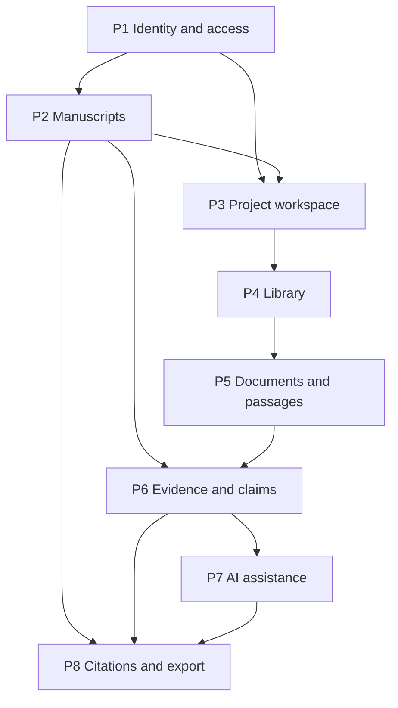

# Доменное развитие PaperWeave — Implementation Plan

## Standalone scope contract

**Outcome:** Последовательно развить локальную основу PaperWeave в исследовательское пространство, где автор работает с рукописью, источниками и доказательствами проекта, а AI возвращает только проверяемые предложения.

**Acceptance criteria:** AC-1…AC-8.

- AC-1 — Вход и права доступа имеют явный контракт; приватность проектов не подразумевается без проверки ownership на каждом API use case.
- AC-2 — Рукопись сохраняется как версионируемый упорядоченный документ; сбой сохранения не теряет введённый текст.
- AC-3 — Рабочее пространство разделяет проектную навигацию, структуру документа, состояние сохранения и контекстную панель.
- AC-4 — Источник, файл и извлечённый фрагмент имеют различимые provenance и состояния.
- AC-5 — Claim и проверенное EvidenceLink различимы; поддержка/противоречие не выводятся из одной лишь цитаты.
- AC-6 — AI proposal содержит выбранный контекст и целевую версию, применяется только явным решением автора и не перезаписывает исходник.
- AC-7 — Цитирование/экспорт ссылается на источник и выдерживает проверку корректности в целевом формате.
- AC-8 — Каждая фаза закрывает собственный контракт, миграции, негативные сценарии и локальные evidence; пользовательский/production rollout отдельно авторизуется.

**Authorization boundary:** This request carries explicit user authorization for local implementation of TASK-005…TASK-014 in sequence. Push, hosted actions, remote/production deployment and external effects are not authorized by this request.

**Non-goals:** Соавторство, приглашения и роли команд, открытая регистрация до отдельного решения, ответы рецензентам, систематический обзор, подбор поставщиков поиска, production deployment, автоматическое принятие AI, автономное доказательство истинности Claim.

**Evidence:** Спецификация поведения, схемы/API-контракты, локальные тесты и ограниченные runtime-проверки по каждой фазе; проверка безопасности и изоляции данных для P1 перед удалённым использованием; итоговая сверка фаз и документации.

**Source:** Запрос пользователя и вложенная концепция от 2026-10-19
**Decisions:** Стек фронтенда Vue 3 + TypeScript + PrimeVue 4; Tiptap — целевой редактор. ADR-0007 фиксирует local-only identity, owner-managed accounts, PostgreSQL server-side sessions (12 часов idle / 7 дней absolute) и миграцию существующих Project на единственного owner. Остальные ADR принимаются перед соответствующими фазами.

## Analysis: child skill result

| Field | Value |
|---|---|
| Child skill | `imp-analysis` |
| Analysis status | complete |
| Analysis artifact | [Analysis и architecture review](../../evidence/plan-analysis/imp-2026-002-domain-workspace.md) |
| Analysis verdict | ACF-1 resolved by owner decision; P1 and P2 verified |
| Architecture status | complete |
| Architecture artifacts | Current P2 review: [manuscript architecture-control](../../evidence/architecture/imp-2026-002-p2-manuscript.json), pass_with_conditions; completed P1 review: [identity architecture-control](../../evidence/architecture/imp-2026-002-p1-identity-access.md) |
| Open blocker refs | none |

## Audited context

**Contract source:** Standalone scope contract из пользовательской концепции; существующий Spec первого MVP остаётся историческим и не расширяется молча.
**Analysis artifact:** [imp-2026-002-domain-workspace.md](../../evidence/plan-analysis/imp-2026-002-domain-workspace.md)
**Implementation phases:** 8; Analysis и Finalization в число фаз не входят.
**Estimated effort:** Не оценивается до определения acceptance criteria каждой доменной фазы.

## General requirements and constraints

### Must not change

- Существующий контракт локального MVP из ADR-0006 и SPEC-2026-001 без отдельной revisions.
- Владение пользовательскими данными, privacy и security semantics без решения владельца.
- Незавершённые/неутверждённые ADR; их статус остаётся `proposed`.
- Production/shared database, внешние API, deployment и удалённые аккаунты в рамках локальной документационной работы.

### Allowed change surface

- Roadmap и implementation planning docs, доменные Specs/ADRs при последующем явно зарегистрированном этапе, backend/frontend в будущих одобренных phase tasks.
- Сначала контракты/модель данных; затем вертикальные срезы домена через существующий API/application-service/storage путь.
- Новые сущности только при самостоятельной идентичности, жизненном цикле, владельце или инварианте.

### Compatibility and migrations

- Любое расширение PostgreSQL schema должно сохранять работоспособность и понятный rollback локальных MVP-данных.
- Привязка ownership к существующим Project rows требует явной стратегии назначения owner; публичный общий доступ не допускается как незаявленный fallback.
- Манускрипт хранится канонически на backend; сериализованный формат редактора версионируется независимо от UI.
- При замене/повторном extraction старые evidence anchors помечаются для проверки, если перенос не доказуем.
- AI proposal адресуется точной версии блока/контекста; устаревшее предложение нельзя применять без повторной проверки.

### Environment matrix

| Environment | In scope? | Purpose | Required evidence | Mutation authorization |
|---|---|---|---|---|
| local | Да, будущие implementation tasks | Изолированная разработка и проверки | unit/integration, локальный Compose при необходимости | `not_required` |
| ci | Не входит в текущий запрос | Hosted pipeline | Отдельный запрос | `not_requested` |
| test | Только test-owned | Тестовые ресурсы | Очистка test-owned данных | `not_requested` |
| staging | Нет | Не задан | — | `not_requested` |
| production | Нет | Не задан | — | `not_requested` |

### Required clarifications

| Uncertainty | Why it matters | Decision owner | Evidence / question | Safe fallback |
|---|---|---|---|---|
| Provisioning и вход | Определяет, кто может стать субъектом доступа | Denis Karmalak | Решено в ADR-0007: первичный owner setup, дальнейшие аккаунты создаёт owner | Удалённая регистрация и приглашения требуют отдельного решения |
| Режим первой поставки и session model | Определяет threat model, cookies/CSRF и deployment boundary | Denis Karmalak | Решение зафиксировано в ADR-0007: local-only, owner-managed accounts, server-side session 12h idle/7d absolute | Удалённый multi-user режим требует отдельного ADR |
| Владение существующими проектами | Без миграции нельзя безопасно вводить фильтрацию доступа | Denis Karmalak | Решено в ADR-0007: одноразово назначить все существующие проекты единственному owner; проверить на disposable DB | Не переносить проекты между пользователями без отдельного решения |
| Scope P4/P8 | Источники, форматы файлов и export style неизвестны | Denis Karmalak | Уточнить, когда будут готовы соответствующие доменные фазы | Не выбирать провайдеры/форматы заранее |

## Fixed decisions and invariants

| Decision / invariant | Rule | Consequence |
|---|---|---|
| Автор контролирует контент | UI показывает сохранение отдельно от AI; AI выдаёт preview; применение требует действия автора | Сохранять исходную версию и решение принятия |
| Источник ≠ Evidence ≠ Claim | Библиографическая запись и цитата не считаются подтверждением тезиса | Хранить provenance и typed relation отдельно |
| Tiptap — UI editor | Editor schema не становится бизнес-источником истины | Серверный контракт рукописи определяет сериализацию и версии |
| Ограниченные доменные модули | Каждый модуль владеет собственными инвариантами; UI/API не дублируют правила | Переиспользовать application services и storage ports |
| MVP остаётся узкой основой | Текущий локальный сценарий не выдаётся за полноценную публикационную систему | Каждая способность проходит собственную acceptance gate |

## Target model

Поток: identity/access → project workspace → manuscript/ordered blocks. Library владеет bibliographic SourceWork и файлами; Documents извлекает Passage из конкретной версии файла; Evidence владеет авторскими Claims, typed links и review state; AI integration возвращает proposal для выбранной версии/контекста; Citations/export формируют внешнее представление. Author остаётся источником истины для текста и review decisions. Jobs вводятся лишь если импорт/extraction/AI требуют долговременной асинхронной работы, retry и восстановления.

Точные поля, cardinality, API схемы, ownership, review enums, retention, anchors, versioning и provider semantics должны быть определены непосредственно перед соответствующей фазой. Ссылки: [Roadmap](../../roadmap.md), [Data model](../../data-model.md), [Architecture](../../architecture.md), [ADR-0002…0006](../../decisions/).

## Work groups and dependency graph

| Group | Purpose | Phases | Outcome |
|---|---|---|---|
| G1 — доступ | Зафиксировать субъекта и границу владения | P1 | Безопасный контракт пользователя и доступа к проекту |
| G2 — письмо | Сделать manuscript ядром рабочего пространства | P2–P3 | Сохраняемый документ и навигационный shell |
| G3 — источники | Ввести библиотеку и извлекаемые фрагменты | P4–P5 | Прослеживаемые source files/passages |
| G4 — аргументация | Связать авторские утверждения с источниками | P6 | Проверяемые Claim/Evidence workflow |
| G5 — помощь и выпуск | Добавить управляемые AI и экспорт | P7–P8 | Авторские предложения и переносимый результат |

Фазы в диаграмме — последовательные гейты. Tasks идут по зарегистрированной очереди после выполнения зависимостей и собственных acceptance criteria.

## Blockers

| ID | Phase | Severity | Status | Evidence | Impact | Owner | Exit condition | Next action |
|---|---|---|---|---|---|---|---|---|
| ACF-1 | P1 | blocking | resolved | Владелец утвердил модель; ADR-0007 зафиксировал provisioning, session lifecycle, режим и owner migration; TASK-006 accepted | До решения нельзя было обещать приватность или фильтровать проекты | Denis Karmalak | Выполнено: migration/backfill/rollback, owner-scoped API и UI подтверждены evidence TASK-006 | Закрыт |

## Architecture findings and phase gates

| ID | Severity | Scope | Phase | Finding / gate | Owner / exit |
|---|---|---|---|---|---|
| ACF-1 | informational | phase | P1 | ADR-0007 принято; TASK-006 accepted с backend/API, UI и disposable migration evidence | Закрыт по acceptance ledger `docs/evidence/verification/TASK-006-acceptance-ledger.yaml` |
| ACF-2 | informational | phases | P2–P8 | Целевые ADR/data model предложены, но не приняты; контракты уточняются по одной доменной фазе | Владелец проекта: принять нужное решение до начала соответствующей реализации |

## Numbered phases

## Phase 1: P1 — Identity and access

**Task:** [TASK-006](../../../tasks/TASK-006.md)

**Expected result:** Решённая модель пользователей/входа и проверяемая изоляция принадлежащих пользователю проектов.

**Tasks:** Реализовать принятый ADR-0007: одноразовую owner setup, owner-managed accounts, server-side PostgreSQL sessions и project ownership; защищённые list/create/get/update use cases; login/error/session-expiry UI; проверить migration/backfill и rollback на disposable DB.

**Dependencies:** [TASK-005](../../../tasks/TASK-005.md) закрыта; ACF-1 снят владельцем, решение записано в ADR-0007.
**Data/API:** User/account identity, Session lifecycle и Project.owner_id закреплены ADR-0007.
**Evidence contract:** Одобренный контракт; тесты allow/deny на list/create/get/update; сессия истекает/отзывается ожидаемо; миграция existing local records проверена на disposable DB; отсутствие межпользовательской утечки.
**Exit criteria:** Нет неавторизованного доступа; project rows имеют определённого владельца либо явно ограниченный local-only режим; миграция и rollback проверены.
**Safe stop:** Удалённый режим остаётся вне scope; не расширять CORS/bind и не заявлять production security.

## Phase 2: P2 — Manuscripts

**Task:** [TASK-007](../../../tasks/TASK-007.md)

**Expected result:** Автор создаёт одну рукопись проекта, редактирует упорядоченные блоки в Tiptap и сохраняет версионируемый документ.

**Tasks:** Реализованы контракт одной рукописи на проект, PostgreSQL JSONB persistence и optimistic version; API чтения/создания/обновления с ownership и conflict checks; Tiptap editor с `dirty/saving/saved/failed` states и retry без очистки документа.

**Dependencies:** P1 verified. Для первого slice Task Outcome ограничивает проект одной рукописью; расширение до нескольких рукописей потребует изменения контракта и миграции.
**Data/API:** `manuscripts` — один документ на `project_id`, `content` хранит полный Tiptap JSON, `version` — монотонная integer revision для optimistic concurrency. Nested GET/POST/PUT endpoints проверяют ownership родительского проекта; stale version возвращает conflict без изменения документа.
**Phase contract:** [TASK-007 contract](../../evidence/verification/TASK-007-contract.yaml); одна текущая рукопись на проект, без исторического revision browser.
**Evidence contract:** Контракт serialization round-trip; тесты создания/чтения/сохранения/конфликта; UI states и retry без очистки текущего текста; сохранность после перезапуска test-owned DB.
**Exit criteria:** Manuscript создаётся и открывается в пределах проекта; сохранённые блоки переживают перезапуск; конфликт не затирает неподтверждённую версию.

## Phase 3: P3 — Project workspace

**Task:** [TASK-008](../../../tasks/TASK-008.md)

**Expected result:** Проект открывается в рабочем shell с левой project/document navigation, центральной рукописью и правой контекстной областью.

**Tasks:** Превратить project detail в workspace navigation; показать список/создание manuscript и sections; построить responsive layout на PrimeVue; показывать project/manuscript context и отдельные save/API/AI states; определить пустые/error/loading states и возврат к списку проектов.

**Dependencies:** P1 и P2 verified.
**Data/API:** Только чтение manuscript/project API и UX-local navigation, без дублирования доменного состояния.
**Evidence contract:** UI route/permission matrix; browser acceptance на пустом, загруженном, ошибочном и узком viewport состоянии; typecheck/build.
**Exit criteria:** Пользователь доходит от проекта до рукописи и раздела, видит отдельные состояния сохранения/API/AI; недоступная область не раскрывает данные.

## Phase 4: P4 — Library

**Task:** [TASK-009](../../../tasks/TASK-009.md)

**Expected result:** Источники и их пользовательские файлы добавляются в библиотеку проекта с сохранением происхождения метаданных.

**Tasks:** Определить SourceWork identity/deduplication и metadata provenance; ограничить формат/размер файла; ввести storage contract/checksum; определить replace/delete/retention; реализовать API и UI списка/деталей/ошибок; закрыть доступ к файлам через ownership gate.

**Dependencies:** P1 verified; P3 workspace; решение по допустимым source/import routes и file retention.
**Data/API:** SourceWork, SourceFile/version и storage key.
**Evidence contract:** Duplicate/ambiguous identity сценарии; MIME/size/path traversal/security checks; пользовательский файл не отдается другому owner; backup/restore стратегия для локального хранилища.
**Exit criteria:** Источник и его файл связаны с проектом и provenance; duplicate/ambiguous import остаётся управляемым; файл изолирован по owner.

## Phase 5: P5 — Documents and passages

**Task:** [TASK-010](../../../tasks/TASK-010.md)

**Expected result:** Из файла источника извлекаются фрагменты с provenance, страницей и ограниченной точностью anchor.

**Tasks:** Выбрать PDF extraction adapter; определить ExtractionRun/version/state; сохранять Passage только относительно конкретной версии SourceFile; отличать extracted/unreviewed от проверенного; предусмотреть retry и partial failure; добавить просмотр текста/страницы и ручное исправление метаданных.

**Dependencies:** P4 verified; решение по формату/языкам PDF, extraction versioning и jobs requirement.
**Data/API:** ExtractionRun, SourcePassage, page/location anchor и processor version.
**Evidence contract:** Fixture PDFs и повреждённый/пустой PDF; повтор без дубликатов; ошибочный extraction сохраняет исходный файл; anchors после замены file требуют проверки.
**Exit criteria:** У Passage есть provenance на конкретную версию файла и метод обработки; extraction failure не создаёт видимость проверенного evidence.

## Phase 6: P6 — Evidence and claims

**Task:** [TASK-011](../../../tasks/TASK-011.md)

**Expected result:** Автор связывает Claim с passages и явно отмечает supports/contradicts/contextualizes с review state.

**Tasks:** Утвердить Claim scope/version, relation types и review lifecycle; связать Claim с блоком рукописи; обеспечить navigation claim↔passage↔source; показывать reviewer, время и состояние; инвалидировать/review link при изменении версии Claim/Passage.

**Dependencies:** P2 и P5 verified; отдельный domain Spec; решение по атрибуции авторских результатов и области review.
**Data/API:** Claim, EvidenceLink, ReviewDecision и version references.
**Evidence contract:** Правила relation/status; тесты связи/отвязки/версии; UI различает цитату, extraction и проверенное evidence; удалённый источник оставляет понятный unresolved state.
**Exit criteria:** Claim, passage, typed relation и review решение прослеживаются; stale links требуют повторной проверки, citation не обозначается как proof.

## Phase 7: P7 — AI assistance

**Task:** [TASK-012](../../../tasks/TASK-012.md)

**Expected result:** Контекстное действие возвращает автору сравнимое предложение, применяемое только явным выбором.

**Tasks:** Утвердить допустимый context manifest и data-sharing UX; описать внутренний LLM service contract/provider config; target version and idempotency; preview/accept/reject; применение как новая manuscript revision; журналировать состояние без хранения лишнего raw content.

**Dependencies:** P1, P2 и P6 verified для evidence-grounded actions; ADR-0004/0005 пересмотрены и приняты для выбранной политики; отдельный Spec.
**Data/API:** AIProposal, target revision/context references и review action.
**Evidence contract:** Provider adapter tests с mock; timeout/error/stale target; reject не меняет документ; accept создаёт новую редакцию; исходный текст доступен; реально передаваемый контекст виден пользователю.
**Exit criteria:** Пользователь видит передаваемый контекст и разницу; отклонение не меняет текст; принятие создаёт новую редакцию; provider failure не скрывает исходник.

## Phase 8: P8 — Citations and export

**Task:** [TASK-013](../../../tasks/TASK-013.md)

**Expected result:** Автор получает экспортируемую рукопись с форматированными ссылками на SourceWork.

**Tasks:** Выбрать export format и citation style; определить библиографические поля и missing metadata behavior; связать inline citation marker с source identity; реализовать export service; проверить документ после round-trip/render.

**Dependencies:** P2, P4 и P6 verified; P7 только если экспорт включает принятые AI changes; формат и citation style утверждены.
**Data/API:** Citation marker, style configuration и export artifact metadata.
**Evidence contract:** golden document fixtures; ссылки/библиография валидны; отсутствующие метаданные видимы; экспорт не меняет исходный manuscript.
**Exit criteria:** Формат выбран; цитаты разрешаются к источникам; неполные метаданные явно отмечены; экспорт проверен без изменения исходной рукописи.

## Required test matrix

| Граница | Сценарии |
|---|---|
| API / persistence | Нормальный путь, validation, not-found, authorization, version conflict, restart persistence |
| UI | Loading/empty/success/failure, keyboard access, responsive PrimeVue states, unsaved changes |
| Storage/documents | Wrong type/oversize/corrupt file, duplicate import, partial extraction, reprocess, missing file |
| Evidence | Relation types, stale source/claim version, review by author, unlink/delete semantics |
| AI | Context preview, provider timeout/error, stale target, reject, accept to new revision, no implicit send |
| Export | Citation integrity, incomplete metadata, stable rendering and no source mutation |

Each future phase selects only its relevant rows and extends them with explicit contracts; this table does not establish a universal coverage target.

## Cross-phase risks and invariants

- P1 is a security/data-ownership boundary; until resolved, all later ownership assumptions stay provisional.
- Long-lived manuscript content must not rely on an unversioned Tiptap-internal JSON shape.
- File bytes and PostgreSQL rows need a recovery story; storage lifecycle is not equivalent to deleting bibliographic metadata.
- Extraction/AI retry must be idempotent or create explicit new runs; partial failure must remain visible.
- Evidence validity is version-dependent; source presence or citation alone is not proof.
- Each user-visible async AI/extraction state is distinct from manuscript save state.
- Local demo/test data is not evidence of production security, backup or deployment readiness.

## Handoff

**Ownership:** Frontend owns interaction/representation; FastAPI transport owns request/response validation; Python application services own use cases; domain modules own invariants; DB/storage adapters own persistence mechanics; integrations own provider protocols.
**Durable state/API:** PostgreSQL is canonical for structured domain state; file storage owns file bytes; API is the only frontend-to-domain boundary. Exact per-domain contracts are phase deliverables.
**Legacy retirement:** Existing project-only UI/API remains until manuscript/workspace routes replace it without breaking current local project access; no rewrite is implied by the plan.
**Required non-goals:** No autonomous AI document mutation, unreviewed evidence, hidden provider transmission, team roles or remote deployment by implication.

## Finalization audit

**Verification Task:** [TASK-014](../../../tasks/TASK-014.md), logical role `IMP-VERIFY:imp-2026-002-domain-workspace`.

Before closure, independently compare every phase contract and evidence with AC-1…AC-8; verify migrations and rollback, API authorization, unsaved-data/error states, source/evidence provenance, AI author control, export integrity, completed Task package and canonical docs (`DOCS.md`, `IMP.md`, `TODO.md`). Confirm each required Task is terminal with attributable evidence, local commits are integrated, and unresolved production/hosted evidence is explicitly out of scope. Do not infer acceptance from code or a local run alone.

## Definition of Done

- P1–P8 are verified or explicitly removed from this plan through a linked successor/revision preserving history.
- AC-1…AC-8 have criterion-specific evidence and no unresolved blocking architecture finding.
- Every necessary domain contract/ADR is accepted by its decision owner; proposed ADRs are not treated as decisions.
- Required local migrations, API/UI and data-recovery gates pass; no unauthorized external effects occur.
- Final verification Task accepts the whole plan, canonical indexes reconcile, and the IMP closure receipt records integrated revisions/evidence.

## Closure

The IMP may become `complete` only after all mandatory phases and final verification pass. It remains `blocked` only for a concrete unresolved condition with owner, impact, exit condition and next step. If the product scope is replaced, set `superseded` only with a linked successor and preserve phase/task history. The user authorized sequential local implementation of TASK-005 through TASK-014; external and production actions remain outside that authorization.
