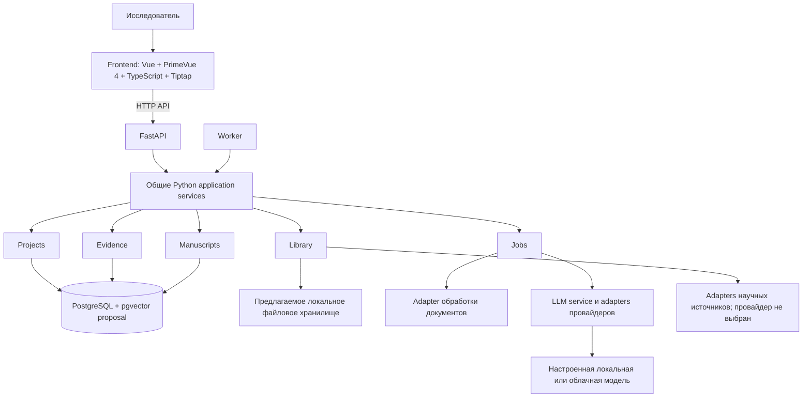

# PaperWeave — карта предметных областей и взаимодействий

## Назначение и статус

Это предлагаемая верхнеуровневая карта продукта и предметных областей. Это не календарь релизов и не план реализации. Текущая проверенная система ограничена локальным runtime и сценариями создания/просмотра исследовательских проектов; остальные компоненты и связи ниже остаются проектными предложениями из материалов пользователя.

## Участник и внешние системы

- **Исследователь / автор:** владеет проектом, выбирает источники, определяет трактовку доказательств и принимает или отклоняет изменения рукописи.
- **Провайдеры научных источников:** возможные внешние сервисы поиска и метаданных; провайдер и API не выбраны.
- **LLM-провайдер:** локальная или облачная модель, endpoint которой задаётся конфигурацией; провайдер и политика передачи данных не определены.
- **Обработчик PDF/документов:** извлекает текст и расположение фрагментов; реализация и форматы помимо начального фокуса PDF не выбраны.
- **PostgreSQL и локальное файловое хранилище:** предлагаемые сервисы хранения структурированных данных и файлов источников.

## Область и исключения

Текущий MVP ограничен локально запускаемой основой, health API и созданием/просмотром проектов с PostgreSQL persistence; его принятое решение — [ADR-0006](decisions/ADR-0006-mvp-boundary.md), подробный поведенческий контракт — [Spec](specs/spec-2026-001-mvp-foundation.md). Последующие возможности наращиваются отдельными ADR и Specs.

Карта продукта включает библиотеку проекта, фрагменты источников, доказательства и утверждения, разделы рукописи, AI-правки под контролем автора, цитирование и экспорт. Проверка соавторами, ответы рецензентам, отбор для систематических обзоров, выбор провайдеров и production-развёртывание пока не описаны.

Пользовательская концепция исследовательского рабочего пространства уточняет основной путь: автор входит в приложение, выбирает проект, редактирует рукопись в центре, ориентируется по структуре слева и открывает источник, доказательство либо предложение AI справа. Локальные вход и управление аккаунтами входят в P1 и описаны в [ADR-0007](decisions/ADR-0007-local-identity-and-project-access.md); остальные части потока остаются целевыми. Последовательность реализации оформлена в [IMP-2026-002](plans/imp/imp-2026-002-domain-workspace.md).

## Основные концептуальные сущности

| Сущность | Идентичность и значение | Владелец / источник истины | Предлагаемый жизненный цикл |
|---|---|---|---|
| `ENTITY-PROJECT` ResearchProject | Стабильный ID проекта, исследовательский вопрос и область | PaperWeave | Создан, активен, архивирован; точные состояния открыты |
| `ENTITY-SOURCE` SourceWork | Научная публикация с DOI или другим стабильным provider/local ID, если он доступен | Библиотека проекта; происхождение внешних метаданных сохраняется | Импортирована, метаданные проверены, исключена из активной библиотеки |
| `ENTITY-SOURCE-FILE` SourceFile | PDF или другое представление источника, предоставленное пользователем | Хранилище проекта пользователя | Сохранён, обработан, заменён/версионирован, удалён по будущей политике retention |
| `ENTITY-SOURCE-PASSAGE` SourcePassage | Цитируемый/извлечённый фрагмент со страницей и, если возможно, координатами PDF; привязан к версии файла | Подсистема evidence | Извлечён, проверен, исправлен |
| `ENTITY-CLAIM` Claim | Утверждение или синтез для аргументации автора | Автор | Черновик, проверка, редакция; модель статусов открыта |
| `ENTITY-EVIDENCE` EvidenceLink | Типизированная связь фрагмента/результата исследования с утверждением, например supports или contradicts | Модель evidence автора | Предложена, проверена автором, заменена |
| `ENTITY-MANUSCRIPT` Manuscript | Версионированная статья с упорядоченными разделами и блоками | Автор | Подготовка, редакция, экспорт |
| `ENTITY-MANUSCRIPT-BLOCK` ManuscriptBlock | Упорядоченная редактируемая единица: текст, таблица, рисунок, заметка или другой блок | Manuscript | Добавлен, изменён, перемещён, удалён с сохранением истории |
| `ENTITY-REVIEW` ReviewState | Решение человека по утверждению, цитате, извлечению или AI-предложению | Автор | Ожидает проверки, принято, отклонено, требует исправления; относится к указанному объекту/версии |

Это концептуальные сущности. Таблицы БД, cardinality, ID, семантика удаления, versioning и владение в многопользовательском режиме не спроектированы и не реализованы.

## Границы предметных областей

- **Projects** отвечает за идентичность проекта, его область и настройки уровня проекта.
- **Library** отвечает за метаданные публикаций и ссылки на файлы; утверждения рукописи ей не принадлежат.
- **Documents** извлекает фрагменты и их расположение; результат extraction остаётся отличимым от evidence, проверенного автором.
- **Evidence** отвечает за утверждения, связи с доказательствами и статусы проверки; фиксирует поддержку или противоречие, не объявляя утверждение объективной истиной.
- **Manuscripts** отвечает за порядок разделов/блоков, редакции, цитирование и представление для экспорта.
- **AI integration** готовит ограниченные предложения по выбранному контексту; не владеет каноническим текстом и не утверждает доказательства.
- **Jobs** отвечает за состояние долгих импортов, extraction и model actions; persistence и семантика retry открыты.
- **Identity and access** (идентичность и доступ) будет отвечать за пользователя, сессию и проверку прав на проектные данные; границы регистрации, восстановления доступа и модели угроз не выбраны. Текущий MVP не аутентифицирует пользователя.
- **Workspace UI** собирает интерфейс проекта вокруг редактора и контекстной панели; он не становится владельцем manuscript, source или evidence state.
- **Citations and export** формируют представление ссылок и рукописи для внешнего документа; источники метаданных, стили и требования экспорта предстоит определить отдельно.

## Основные потоки данных и управления

| Поток | Вход | Данные и управление | Ошибка и восстановление | Владелец |
|---|---|---|---|---|
| `FLOW-MVP-FOUNDATION` Локальная основа | Запуск приложения и запросы пользователя | Vue UI → FastAPI → Projects scenario → PostgreSQL; readiness проверяет DB, liveness — только API; миграция до готовности | UI переживает недоступность API; readiness возвращает 503 при проблеме БД; проект сохраняется между запусками | Автор и владельцы технических границ |

| `FLOW-RESEARCH` От вопроса к рукописи | Исследовательский вопрос и PDF-источники | Project → library/source → извлечённые фрагменты → evidence/claims → разделы рукописи → проверка цитат и export | Сохранять источник и ошибку extraction; разрешать исправление метаданных или повторную обработку без потери проверенных доказательств | Исследователь и владельцы подсистем |
| `FLOW-MVP` Первый проверочный сценарий | Один PDF и выбранный фрагмент | Импорт PDF → извлечение фрагмента → запрос объяснения → AI-предложение со ссылкой на фрагмент → сохранение/редактирование заметки со ссылкой на источник | Показывать ошибку extraction/model call; не считать проверенным неудачный или непроверенный результат | Исследователь |
| `FLOW-AI-EDIT` AI-правка рукописи | Выбранный блок и явная задача/контекст | UI фиксирует блок/версию и выбранные источники → LLM service/provider adapter → структурированное предложение → preview → accept/reject → новая редакция при принятии | Ошибка провайдера видна и записана; исходный блок сохранён; устаревшее предложение нужно обновить или пересобрать | Автор принимает решение |

| `FLOW-WORKSPACE` Работа автора в проекте | Вошедший пользователь и выбранный проект/рукопись | Identity/access → project workspace → manuscript blocks; контекстная панель читает выбранные sources/evidence и отправляет явные AI-действия через API | Истечение сессии, ошибки сохранения и AI показываются раздельно; несохранённый текст сохраняется или восстанавливается по контракту рукописи; предложение не меняет документ до принятия | Автор; владельцы соответствующих доменных модулей |

Потоки `FLOW-RESEARCH`, `FLOW-MVP` и `FLOW-AI-EDIT` — целевые концепции. `FLOW-WORKSPACE` добавляет вход и рабочую оболочку к последующему развитию; контракты его доменных фаз указаны в IMP, а не определяются этой картой.

## Схема компонентов верхнего уровня

Диаграмма показывает целевые границы ответственности, а не развёрнутые процессы. Поток записи статьи: Vue/Tiptap → HTTP API → FastAPI → общие Python application services → доменные модули и хранилища. Worker вызывает те же services, не дублируя правила обработки. Точные API-контракты, локальная сборка и раздача frontend-ресурсов не определены.

## Границы доверия и инварианты

- Внешний источник или ответ модели считается непроверенным вводом, пока его не сверили с первоисточником.
- Наличие цитаты не доказывает, что источник подтверждает утверждение.
- Текст от AI остаётся предложением, пока автор его не принял.
- У значимых утверждений должны сохраняться ссылки на фрагменты источников и блоки рукописи, где они использованы.
- Текст источника, интерпретация автора и собственные результаты автора должны оставаться различимыми.
- Передача данных внешнему провайдеру должна быть явной; механизмы контроля не выбраны.

## Риски и направления развития

Идентичность и дедупликация публикаций, anchors фрагментов PDF, versioning рукописи, семантика статусов evidence, повторы jobs, удалённая аутентификация и совместный доступ, privacy controls провайдеров, форматы библиографии и экспорта требуют решений до соответствующих фаз. Локальная идентификация и ownership ограничены [ADR-0007](decisions/ADR-0007-local-identity-and-project-access.md). Внутреннее устройство редактора можно менять без изменения основных контрактов источника и evidence, если они останутся стабильными.

## Когда пересматривать карту

Пересматривай карту после принятия ADR, изменения границы основной предметной области, выбора провайдера или владельца хранения либо появления в коде/schema существенно нового потока. Для текущей локальной основы используй [IMP-2026-001](plans/imp/imp-2026-001-mvp-foundation.md); карта не заменяет её фазовые evidence.
