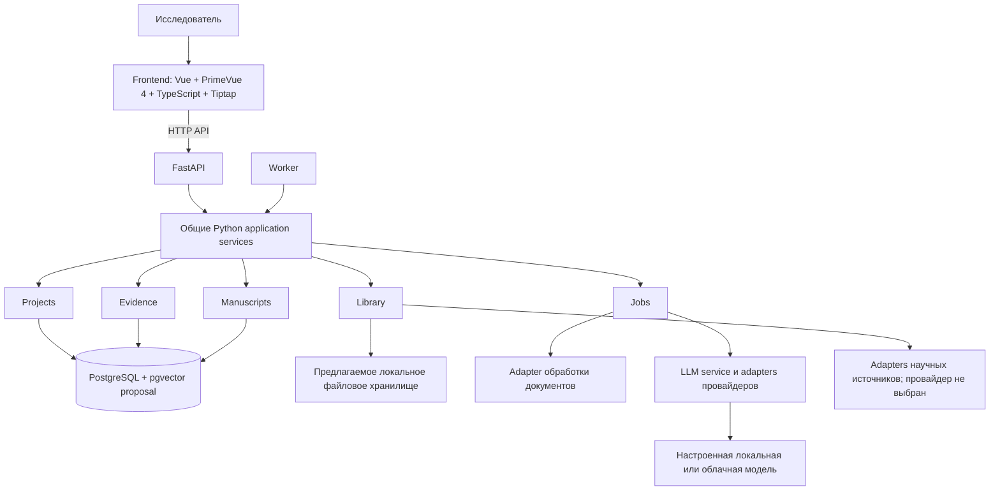

# PaperWeave — карта предметных областей и взаимодействий

## Назначение и статус

Это верхнеуровневая карта продукта и предметных областей, а не календарь релизов. Начальная основа из ADR-0006 была последовательно расширена в [IMP-2026-002](plans/imp/imp-2026-002-domain-workspace.md): P1–P8 завершены как локальные сценарии доступа, рукописи, workspace, ручной PDF-библиотеки, extraction, evidence review, mock-only AI и DOCX. Таблицы ниже описывают целевую предметную модель; её фактическая реализация намеренно уже и обозначена по доменам.

## Участник и внешние системы

- **Исследователь / автор:** владеет проектом, выбирает источники, определяет трактовку доказательств и принимает или отклоняет изменения рукописи.
- **Провайдеры научных источников:** возможные внешние сервисы поиска и метаданных; провайдер и API не выбраны.
- **LLM-провайдер:** для P7 подключён только детерминированный mock; реальный локальный/облачный провайдер, endpoint и политика передачи данных не выбраны и не используются.
- **Обработчик PDF/документов:** P5 использует pypdf для извлечения доступного текстового слоя локального PDF без OCR; другие форматы и обработка сканов не входят в текущий срез.
- **PostgreSQL и файловое хранилище:** PostgreSQL хранит структурированные данные и каталог пользовательских артефактов; байты размещаются через локальный файловый адаптер или S3 backend. Для локальной Compose-разработки интегрирован SeaweedFS `4.48`; это не утверждает готовность production-развёртывания. Автоматическое production backup/restore не реализовано.

## Область и исключения

Начальная основа описана в [ADR-0006](decisions/ADR-0006-mvp-boundary.md) и [SPEC-2026-001](specs/spec-2026-001-mvp-foundation.md). Текущее локальное расширение P1–P8 проверено в [IMP-2026-002](plans/imp/imp-2026-002-domain-workspace.md) и его final audit; это не означает удалённого multi-user режима или production rollout.

Карта продукта включает библиотеку проекта, фрагменты источников, доказательства и утверждения, разделы рукописи, AI-правки под контролем автора, цитирование и экспорт. Проверка соавторами, ответы рецензентам, отбор для систематических обзоров, выбор провайдеров и production-развёртывание пока не описаны.

Пользовательская концепция исследовательского рабочего пространства уточняет основной путь: автор входит в приложение, выбирает проект, редактирует рукопись в центре, ориентируется по структуре слева и открывает источник, доказательство либо предложение AI справа. Локальные вход и управление аккаунтами входят в P1 и описаны в [ADR-0007](decisions/ADR-0007-local-identity-and-project-access.md); остальные части потока остаются целевыми. Последовательность реализации оформлена в [IMP-2026-002](plans/imp/imp-2026-002-domain-workspace.md).

## Основные концептуальные сущности

| Сущность | Идентичность и значение | Владелец / источник истины | Предлагаемый жизненный цикл |
|---|---|---|---|
| `ENTITY-PROJECT` ResearchProject | Стабильный ID проекта, исследовательский вопрос и область | PaperWeave | Создан, активен, архивирован; точные состояния открыты |
| `ENTITY-SOURCE` SourceWork | Научная публикация с DOI или другим стабильным provider/local ID, если он доступен | Библиотека проекта; происхождение внешних метаданных сохраняется | Импортирована, метаданные проверены, исключена из активной библиотеки |
| `ENTITY-SOURCE-FILE` SourceFile | PDF или другое представление источника, предоставленное пользователем | Хранилище проекта пользователя | Сохранён, обработан, заменён/версионирован, удалён по будущей политике retention |
| `ENTITY-SOURCE-PASSAGE` SourcePassage | Цитируемый/извлечённый фрагмент со страницей и, если возможно, координатами PDF; привязан к версии файла | Подсистема evidence | Извлечён, проверен, исправлен |
| `ENTITY-CLAIM` Claim | Утверждение или синтез для аргументации автора | Автор | Черновик, проверка, редакция; модель статусов открыта |
| `ENTITY-EVIDENCE` EvidenceLink | Типизированная связь фрагмента/результата исследования с утверждением, например supports или contradicts | Модель evidence автора | Предложена, проверена автором, заменена |
| `ENTITY-MANUSCRIPT` Manuscript | Версионированная статья с упорядоченными разделами и блоками | Автор | Подготовка, редакция, экспорт |
| `ENTITY-MANUSCRIPT-BLOCK` ManuscriptBlock | Упорядоченная редактируемая единица: текст, таблица, рисунок, заметка или другой блок | Manuscript | Добавлен, изменён, перемещён, удалён с сохранением истории |
| `ENTITY-REVIEW` ReviewState | Решение человека по утверждению, цитате, извлечению или AI-предложению | Автор | Ожидает проверки, принято, отклонено, требует исправления; относится к указанному объекту/версии |
| `ENTITY-USER-ARTIFACT` UserArtifact | Типизированная запись о файле пользователя: назначение, владелец, object key, media type, размер, checksum, версия и состояние обработки | Пользовательский аккаунт; метаданные в PostgreSQL, байты в storage adapter | Загружен, проверен, доступен, заменён/версионирован, удалён по retention-политике |

Эта таблица задаёт концептуальную целевую модель. В локальном срезе реализованы ограниченные формы Project/owner, Source/SourceFile, SourcePassage/ExtractionRun, Claim/EvidenceLink/ReviewDecision, одной Manuscript с revisions, AIProposal и citation marker. Более широкие ResearchQuestion/StudyExtraction/Jobs, многопользовательская модель и дополнительные состояния не реализованы; детали фактической схемы приведены в [Data Model](data-model.md).

## Типизированные пользовательские артефакты и S3-хранилище

Локальный срез интеграции реализован в TASK-020: SeaweedFS `4.48` запускается как S3 backend, а PostgreSQL хранит типизированные ссылки и lifecycle-метаданные в `file_artifacts`. Архитектурная граница оставляет локальный файловый backend и допускает замену S3-реализации. Это не является решением о production-развёртывании; SeaweedFS документирует поддержку S3 object storage наряду с другими режимами хранения ([проект SeaweedFS](https://github.com/seaweedfs/seaweedfs)).

Целевая концепция отделяет файловые байты от предметных данных и от конкретного backend:

- PostgreSQL хранит метаданные `UserArtifact` и доменные связи; выбранный адаптер хранит байты по непрозрачному ключу. Общий storage-интерфейс поддерживает локальное хранилище и S3 backend, а локальный Compose использует SeaweedFS.
- Начальные типы назначения: `avatar` (аватар аккаунта), `image` (изображения пользователя/проекта, в том числе иллюстрации рукописи) и `document` (PDF-источник и иные поддержанные документы). Тип назначения отделён от проверенного фактического media type и формата файла. Допустимые форматы и лимиты определяются отдельно для каждого типа.
- Для каждого артефакта предполагаются стабильный ID, владелец-пользователь, необязательная ссылка на проект/предметный объект, тип назначения, storage backend/key, исходное отображаемое имя, media type, размер, checksum, версия, времена загрузки/обновления и состояние проверки/обработки. Пароли, S3 credentials и публичные URL не являются метаданными артефакта.
- Доступ проверяется приложением по владельцу и доменным связям. Bucket и внутренний endpoint не публикуются браузеру; S3 credentials остаются только на сервере. Прямые браузерные загрузки по временным ссылкам можно рассмотреть позже, с коротким сроком действия и ограничением на конкретный ключ/операцию.
- Замена аватара сначала сохраняет и проверяет новый объект, затем атомарно переключает активную ссылку в PostgreSQL и ставит старый объект на очистку; повторные попытки сохраняют lifecycle-запись. Документы защищены проверкой доменных ссылок перед удалением. Перенос файлов между backend требует отдельной операции, сохраняющей IDs, версии, checksums и ссылки.
- Перед внедрением требуется определить backup/restore и проверку восстановления пары PostgreSQL metadata + object bytes, сиротские объекты/записи, повторяемость загрузок, ограничения размера/контента, антивирусную/форматную проверку документов и политику логирования без содержимого файлов.

Эта область расширяет границу хранения из [ADR-0005](decisions/ADR-0005-user-owned-data.md), где локальное файловое хранилище предусмотрено за storage-интерфейсом. Она не меняет принятый ADR: production-развёртывание SeaweedFS, backup/restore, retention, перенос между backend и эксплуатационная политика остаются открытыми решениями. Фактический контракт и lifecycle описаны в [хранении пользовательских файлов](storage-artifacts.md).

## Границы предметных областей

- **Projects** отвечает за идентичность проекта, его область и настройки уровня проекта.
- **Library** отвечает за метаданные публикаций и ссылки на файлы; утверждения рукописи ей не принадлежат.
- **Documents** извлекает фрагменты и их расположение; результат extraction остаётся отличимым от evidence, проверенного автором.
- **Evidence** отвечает за утверждения, связи с доказательствами и статусы проверки; фиксирует поддержку или противоречие, не объявляя утверждение объективной истиной.
- **Manuscripts** отвечает за порядок разделов/блоков, редакции, цитирование и представление для экспорта.
- **AI integration** готовит ограниченные предложения по выбранному контексту; не владеет каноническим текстом и не утверждает доказательства.
- **Jobs** отвечает за состояние долгих импортов, extraction и model actions; persistence и семантика retry открыты.
- **Identity and access** реализует локальный owner setup, owner-managed accounts, PostgreSQL sessions и owner-scoped доступ к проектным данным по [ADR-0007](decisions/ADR-0007-local-identity-and-project-access.md). Удалённый multi-user режим, приглашения, recovery и production threat model остаются вне текущей границы.
- **Workspace UI** собирает интерфейс проекта вокруг редактора и контекстной панели; он не становится владельцем manuscript, source или evidence state.
- **Citations and export** связывают inline-ссылки с Source проекта и формируют DOCX: числовые ссылки по ГОСТ Р 7.0.5–2008, описания списка литературы по ГОСТ Р 7.0.100–2018. P8 использует только имеющиеся ручные метаданные и явно показывает незаполненные поля; расширение схемы источников остаётся будущим решением.

## Основные потоки данных и управления

| Поток | Вход | Данные и управление | Ошибка и восстановление | Владелец |
|---|---|---|---|---|
| `FLOW-MVP-FOUNDATION` Локальная основа | Запуск приложения и запросы пользователя | Vue UI → FastAPI → Projects scenario → PostgreSQL; readiness проверяет DB, liveness — только API; миграция до готовности | UI переживает недоступность API; readiness возвращает 503 при проблеме БД; проект сохраняется между запусками | Автор и владельцы технических границ |

| `FLOW-RESEARCH` От вопроса к рукописи | Исследовательский вопрос и PDF-источники | Project → library/source → извлечённые фрагменты → evidence/claims → разделы рукописи → проверка цитат и export | Сохранять источник и ошибку extraction; разрешать исправление метаданных или повторную обработку без потери проверенных доказательств | Исследователь и владельцы подсистем |
| `FLOW-MVP` Первый проверочный сценарий | Один PDF и выбранный фрагмент | Импорт PDF → извлечение фрагмента → запрос объяснения → AI-предложение со ссылкой на фрагмент → сохранение/редактирование заметки со ссылкой на источник | Показывать ошибку extraction/model call; не считать проверенным неудачный или непроверенный результат | Исследователь |
| `FLOW-AI-EDIT` AI-правка рукописи | Выбранный блок и явная задача/контекст | UI фиксирует блок/версию и выбранные источники → LLM service/provider adapter → структурированное предложение → preview → accept/reject → новая редакция при принятии | Ошибка провайдера видна и записана; исходный блок сохранён; устаревшее предложение нужно обновить или пересобрать | Автор принимает решение |

| `FLOW-WORKSPACE` Работа автора в проекте | Вошедший пользователь и выбранный проект/рукопись | Identity/access → project workspace → manuscript blocks; контекстная панель читает выбранные sources/evidence и отправляет явные AI-действия через API | Истечение сессии, ошибки сохранения и AI показываются раздельно; несохранённый текст сохраняется или восстанавливается по контракту рукописи; предложение не меняет документ до принятия | Автор; владельцы соответствующих доменных модулей |

Потоки `FLOW-RESEARCH` и полные `FLOW-MVP`/`FLOW-AI-EDIT` остаются целевыми концепциями и не подтверждают сквозную передачу текста реальному провайдеру. Локальный `FLOW-WORKSPACE` в P1–P8 поддерживает вход владельца, проект, рукопись, источники/evidence, mock-only предложения и DOCX export; критерии и ограничения указаны в IMP.

## Схема компонентов верхнего уровня

Диаграмма показывает целевые границы ответственности, а не развёрнутые процессы. Поток записи статьи: Vue/Tiptap → HTTP API → FastAPI → общие Python application services → доменные модули и хранилища. Worker вызывает те же services, не дублируя правила обработки. Точные API-контракты, локальная сборка и раздача frontend-ресурсов не определены.

## Границы доверия и инварианты

- Внешний источник или ответ модели считается непроверенным вводом, пока его не сверили с первоисточником.
- Наличие цитаты не доказывает, что источник подтверждает утверждение.
- Текст от AI остаётся предложением, пока автор его не принял.
- У значимых утверждений должны сохраняться ссылки на фрагменты источников и блоки рукописи, где они использованы.
- Текст источника, интерпретация автора и собственные результаты автора должны оставаться различимыми.
- Передача данных внешнему провайдеру должна быть явной; механизмы контроля не выбраны.

## Риски и направления развития

Идентичность и дедупликация публикаций, anchors фрагментов PDF, versioning рукописи, семантика статусов evidence, повторы jobs, удалённая аутентификация и совместный доступ, privacy controls провайдеров, форматы библиографии и экспорта требуют решений до соответствующих фаз. Локальная идентификация и ownership ограничены [ADR-0007](decisions/ADR-0007-local-identity-and-project-access.md). Внутреннее устройство редактора можно менять без изменения основных контрактов источника и evidence, если они останутся стабильными.

## Когда пересматривать карту

Пересматривай карту после принятия ADR, изменения границы основной предметной области, выбора провайдера или владельца хранения либо появления в коде/schema существенно нового потока. Для текущей локальной основы используй [IMP-2026-001](plans/imp/imp-2026-001-mvp-foundation.md); карта не заменяет её фазовые evidence.
